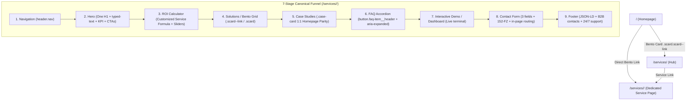

# Architectural Reference & Production Blueprint: ai-avtopilot.ru

> **Status**: Production Hardened | **Updated**: 2026-10-05  
> **Live URL**: [https://ai-avtopilot.ru/](https://ai-avtopilot.ru/) | **Repo**: `Vlad-Voro/ai-avtopilot` (`main` - Private)  
> **Local Root**: `d:\AI\data\ai-avtopilot`  
> **Verification Matrix**: **153 / 153 PASS** (Tier 1: 11 Unit + Tier 2: 54 Static + Tier 3: 88 Browser E2E, 0 regressions)


---

## 1. Edge Infrastructure & Network Topology

```mermaid
flowchart TD
    Client["Client Browser"] -->|HTTPS / TLS 1.3 / Anycast 76.76.21.21| Vercel["Vercel Edge Network (Hobby Tier)"]

    subgraph EdgeLayer ["1. Edge & DNS Layer (Vercel + Cloudflare Grey Cloud)"]
        Vercel -->|1. Static Assets & Subpages| VEdge["Vercel Anycast Edge (vercel.json)"]
        Vercel -->|2. POST /submit (Lead Ingestion)| CFW["Cloudflare Worker (ai-avtopilot-bot)"]
        VEdge -->|3. Security Headers + 1y Cache| VSec["HSTS, CSP, Frame Guard, Permissions-Policy"]
        VEdge -->|4. Deployment Isolation| VIgn[".vercelignore (blocks _headers, *.md, tests, bot)"]
    end

    subgraph AppLayer ["2. Multi-Entry Hybrid SSG"]
        VEdge --> P1["/ (Main Landing)"]
        VEdge --> P2["/services/ (Hub & Cluster)"]
        VEdge --> P3["/cases/ (Hub & Cluster)"]
        VEdge --> P4["/calculator/ (ROI Engine)"]
        VEdge --> P5["/dashboard/ (Telemetry Simulator)"]
        VEdge --> P6["/faq/ (B2B Accordion)"]
        VEdge --> P7["/contact/ (Express Audit Capture)"]
    end

    subgraph Ingestion ["3. Resilient Ingestion & Notifications"]
        CFW -->|Primary: HTML Telegram API| TGB["Telegram Bot @AiAvtopilotbot"]
        TGB --> Admin["Duty Administrator"]
        CFW -.->|Fallback on network error| W3F["Web3Forms + FormSubmit.co"]
        W3F -.-> Mail["contact@ai-avtopilot.ru"]
    end

    subgraph Monitoring ["4. Synthetic CI/CD Monitoring"]
        GHA["GitHub Actions (healthcheck.yml)"] -->|Daily Cron + Push Verification| Vercel
    end
```

### 1.1. DNS, Routing & Anti-Throttling (TSPU DPI Resilience)
- **Apex & Subdomains**: `ai-avtopilot.ru` (REG.RU registrar).
  - A `@` $\to$ `76.76.21.21` (Vercel Global Anycast Edge; zero 24KB DPI stall in Russia).
  - CNAME `www` $\to$ `cname.vercel-dns.com` (canonical 301 redirect to apex).
  - Cloudflare Mode: **DNS only (Grey Cloud)** + **DNSSEC** (DS 2371). Bypasses Russian TSPU DPI throttling on Cloudflare proxies.
- **Cold Disaster Recovery Backup (ADR 2026-09-28)**:
  - Beget origin hosting (RU IP `185.50.25.55`) retained as cold disaster recovery (DR) fallback via automated FTPS deployment (`deploy.yml`).
- **Webmaster Ownership**:
  - Google Search Console: DNS TXT `google-site-verification=u42j0jjBKadmyE77f9wlqfy5gkyDONXtaPzcPRZ51R8` + meta tag.
  - Yandex Webmaster: HTML verification file `/yandex_cd29b4304b5e16c6.html` (HTTP 200, cleanUrls bypassed for verification).
- **Security & Caching Rules (`vercel.json`)**:
  - Trailing slash normalization: `"trailingSlash": true` (canonical 308 redirect, zero multi-hop downgrades).
  - Static assets: `/assets/*` $\to$ `Cache-Control: public, max-age=31536000, immutable`.
  - HTML documents: `Cache-Control: public, max-age=0, must-revalidate`.
  - Isolation via `.vercelignore`: blocks `_headers`, `*.md`, `tests/**`, `bot/**`, `cloudflare-worker/**`, `scripts/**`, `.htaccess`, `push_to_github.ps1`.
  - Security headers: `X-Content-Type-Options: nosniff`, `X-Frame-Options: SAMEORIGIN`, `Referrer-Policy: strict-origin-when-cross-origin`, `Strict-Transport-Security: max-age=31536000; includeSubDomains; preload`, `Permissions-Policy`.
- **Mail Authentication**:
  - SPF: `v=spf1 include:_spf.mx.cloudflare.net ~all`.
  - DMARC: `_dmarc.ai-avtopilot.ru TXT "v=DMARC1; p=none; sp=none; aspf=r;"`.

---

## 2. Frontend Architecture & Design System

### 2.1. Web Vitals & Zero-Blocking Engine
- **Inlined CSS**: Master stylesheet embedded directly in `<head>` via `<style id="app-styles">` (~97 KB). Zero render-blocking external stylesheets.
- **Font Subsetting & Local WOFF2 Isolation**: Zero external Google Fonts CDN dependencies across all 27 pages (including `/success.html` and `/404.html`). Local WOFF2 fonts (*Inter* Cyrillic/Latin, *Outfit* headings, *JetBrains Mono*) preloaded via `<link rel="preload">` in `/assets/fonts/` with `font-display: optional / swap` (0 CLS, immune to Russian TSPU DPI blocking).
- **CWV Targets**: FCP 0.3s–0.5s | LCP 0.5s–0.6s | TBT 0 ms | CLS 0.000 (fixed dimensions on terminals, sliders, and bento cards).
### 2.2. Strict Palette & Contrast (WCAG AA Compliant)
- Background: `#050507` (Deep Cosmic Black).
- Text Tier 1 (`--text-1`): `#ffffff` (21:1 contrast).
- Text Tier 2 (`--text-2`): `#cbd5e1` (13.7:1 contrast on `#050507`).
- Text Tier 3 (`--text-3`): `#94a3b8` (7.9:1 contrast, exceeds WCAG AA 4.5:1).
- Accents: Indigo `--accent: #6366f1`, Purple `--accent-2: #a855f7`, Border glow `rgba(99, 102, 241, 0.25)`.
- Cards (`.scard`, `.case-card`, `.dash-card`): 4px hover elevation, `box-shadow: 0 12px 36px rgba(99, 102, 241, 0.18)`.

### 2.3. Breakpoints & Accessibility
- Viewports: `1440px`, `1200px`, `1024px`, `768px`, `414px`, `375px`, `320px`. Zero horizontal overflow (`overflow-x: clip / hidden`).
- Mobile Navigation: Touch target $\ge 48\text{px}$, synchronous `aria-expanded`, body scroll lock (`overflow: hidden`), auto-close on `Escape` or nav link click.
- Motion Sensitivity: `@media (prefers-reduced-motion: reduce)` disables particles, transforms, and pulsating glows.

---

## 3. Multi-Entry Hybrid SSG & Navigation Engine

```text
index.html (Master Template) & Data Catalogs
   │
   ├── [sync_pages.py] ──────────> 6 Hub & Tool Pages (/services/, /cases/, etc.)
   ├── [build_service_page.py] ──> 8 Standard Service Landing Pages (/services/<slug>/) + #other-services
   ├── [build_ai_analytics_page] ─> /services/ai-analytics/ + #other-services
   ├── [build_reporting_page] ────> /services/automated-reporting/ + #other-services
   └── [build_case_page.py] ─────> 7 Applied Case Studies (/cases/<slug>/) with #cases below #contact
```

- **SSG Synchronization**:
  ```powershell
  python data/ai-avtopilot/scripts/sync_pages.py
  python data/ai-avtopilot/scripts/build_service_page.py --all
  python data/ai-avtopilot/scripts/build_ai_analytics_page.py
  python data/ai-avtopilot/scripts/build_reporting_page.py
  python data/ai-avtopilot/scripts/build_case_page.py --all
  ```

- **SOTA 404 Fallback**: Root `/404.html` caught natively by Vercel; preserves original request path, executes client-side `history.replaceState`, and restores target state without broken redirects.
- **Deterministic ScrollSpy & Subpage Isolation (ADR 2026-10-01)**:
  - Active section calculated deterministically via DOM geometry (`getActiveSection()`) based on scroll offset (`window.scrollY + offset`).
  - Clears active underline on `#home`.
  - **Subpage Isolation Guard**: `const isSubpage = window.location.pathname.startsWith('/services') || document.querySelector('.subpage-deep')`. Bypasses `history.replaceState` during scroll on subpages, preserving clean URLs (`/services/system-integration/`) and preventing SEO stripping.

---

## 4. Interactive Engines & Mathematical Contracts

### 4.1. ROI Calculator Exact Specifications
- **Input Boundaries**:
  - Employee count: $E \in [1, 100]$, step 1.
  - Routine hours/week per employee: $H \in [1, 40]$, step 1.
  - Average monthly salary: $S \in [30\,000, 300\,000]$ RUB, step $5\,000$ RUB.
- **Formulas**:
  $$\text{Routine Fraction: } D = \frac{H}{160}$$
  $$\text{Annual Routine Cost: } M = E \times S \times D \times 12$$
  $$\text{Annual Savings (80% Efficiency): } W = M \times 0.80$$
  $$\text{Freed Hours Per Year: } X = E \times H \times 52$$
- **UI & Slider Implementation**:
  - Track: 7px height, 999px border-radius.
  - CSS Dynamic Gradient Fill:
    `background: linear-gradient(to right, #6366f1 0%, #a855f7 pct%, rgba(255, 255, 255, 0.1) pct%, rgba(255, 255, 255, 0.1) 100%)`.
  - Canonical Output IDs: `#roi-cost`, `#roi-save`, `#roi-hours` formatted via Russian currency locale (`ru-RU`).

### 4.2. Hero Particle Canvas (CPU & Battery Guard)
- **Density**: Desktop ($\ge 768\text{px}$) 40 particles; Mobile ($< 768\text{px}$) 18–20 particles (-75% CPU load).
- **Lifecycle**: `IntersectionObserver` halts `requestAnimationFrame` loop when Hero leaves viewport; resumes instantly on re-entry.

### 4.3. Live Dashboard Telemetry Simulator
- Simulated telemetry streams (intervals: 3500ms and 2100ms).
- Pauses execution during inactive browser tabs via `visibilitychange` (`document.hidden === true`), eliminating background CPU and memory leaks.

### 4.4. KPI Counter Animation Engine & Metric Units Architecture (ADR 2026-10-02)
- **Lifecycle & Precision**: Numbers interpolate smoothly via `requestAnimationFrame` over 1200ms with ease-out quad timing upon crossing `IntersectionObserver` viewport threshold (`threshold: 0.15`).
- **Metric Units Integrity Contract**:
  - The numeral parser strictly isolates pure numeric stems while preserving prefix signs (`+`, `−`), decimal separators (`.`, `,`), and metric suffixes (`%`, `₽`, `ч`, `сек`, `млн ₽`).
  - Example transforms: `+18%` interpolates $0 \to 18$ while rendering `+18%`; `9 200 ч` interpolates $0 \to 9200$ formatted as `9 200 ч`; `80.4%` preserves single decimal precision.
  - Zero raw integer stripping: never renders naked integers where business units or decimal precisions are defined.

---

## 5. Ingestion Gateway, Edge Security & Anti-Bot Defense

### 5.1. Cloudflare Worker Gateway (`cloudflare-worker/worker.js`)
- **Endpoint**: `POST https://ai-avtopilot-bot.mr-vladimir-voronin.workers.dev/submit`.
- **Whitelisted Origins**: `https://ai-avtopilot.ru`, `https://www.ai-avtopilot.ru`, `https://vlad-voro.github.io`.
- **Sliding-Window Rate Limiting**: Max 5 requests per 10 minutes per IP with automatic stale IP pruning (>2000 records).
- **Zero-Overhead Anti-Bot Defense**:
  - *Time-to-Submit*: Drops submissions completed under 1.0s (inhuman speed).
  - *User Interaction Tracker*: Validates client interaction events (`input`, `focus`, `touchstart`).
  - *Honeypot*: Hidden field `_honey`; non-empty submissions return HTTP 200 silently without Telegram dispatch.
- **Telegram HTML Sanitization**:
  - Allowed entities: strictly `&lt;`, `&gt;`, `&amp;`, `&quot;`.
  - **Prohibited `&#039;`**: Escaping single quotes as `&#039;` triggers `Telegram 400 Bad Request` and drops leads.
- **Anti-Hijacking Reply Parser**: Regex `^🆔 ID клиента: <code>(\d+)</code>` isolates client ID, preventing prompt injection in user quotes.

### 5.2. Lead Failover Cascade
1. **Primary**: Worker $\to$ Telegram bot [@AiAvtopilotbot](https://t.me/AiAvtopilotbot) to duty administrator.
2. **Timeout**: Fetch aborted via `AbortController` after 6000ms.
3. **Secondary**: Web3Forms API $\to$ FormSubmit.co $\to$ `contact@ai-avtopilot.ru`.
4. **Offline Fallback UI**: On catastrophic network failure, UI shows fallback card with 1-click clipboard payload copy and direct Telegram contact button.

---

## 6. SEO, GEO & AEO (Generative Search Optimization)

### 6.1. Search Engine & AI Crawler Directives (`robots.txt`)
- Explicitly permits 10 AI crawler bots: `GPTBot`, `OAI-SearchBot`, `PerplexityBot`, `ClaudeBot`, `Applebot-Extended`, `Amazonbot`, `Cohere-ai`, `Meta-ExternalAgent`, `Google-Extended`, `Yandex`.
- Ad tracking URL deduplication:
  ```txt
  Clean-param: utm_source&utm_medium&utm_campaign&utm_content&utm_term&yclid&_openstat&from&vk_source&gclid&fbclid /
  ```
- Fast RAG Machine Context: `/llms.txt` and `/llms-full.txt` (1C OData, Diadoc SDK, SBIS, 152-FZ on-premise).

### 6.2. Schema.org JSON-LD (@graph)
- `Organization` & `ProfessionalService`: RUB currency, areaServed "Russian Federation, Moscow", 152-FZ taxonomies.
- `FAQPage`: B2B questions matching DOM accordion 1:1.
- `BreadcrumbList`: Structural 3-tier hierarchy across all subpages.
- `TechArticle`: Deep metadata for dedicated case study pages.

### 6.3. Advanced Discovery, Instant Nav & Machine Discovery Protocols
- **Chrome Speculation Rules API**: Embedded `<script type="speculationrules">` across all HTML pages for instant subpage transitions with moderate prerender rules.
- **LLMs.txt v2 Discovery**: `<link rel="describedby" href="/llms.txt">` declared in `<head>` of all pages for autonomous agent discovery.
- **RFC 9116 Security Policy**: `/.well-known/security.txt` containing verified security contact channels, PGP canonical endpoint, and policy expiry.
- **IndexNow Engine**: Automated push via `scripts/seo/push_indexnow.py` keyed by root token `d8a24f0c9b7e416a9e3d81b7e651c4a0.txt` for real-time Yandex and Bing index updates.

---

## 7. Security & Zero-Trust Hardening

| Vector | Implementation | Protection |
| :--- | :--- | :--- |
| **OWASP Clickjacking** | Inline `<head>` guard: `if (self !== top) top.location = self.location;` with instant `body{display:none}` removal | Blocks malicious iframe embedding |
| **Content Security Policy** | `default-src 'self'`; whitelist for `mc.yandex.ru`, Cloudflare Worker, Web3Forms, local fonts | Mitigates XSS and script injections |
| **X-Content-Type-Options** | `nosniff` meta tag & edge header | Prevents MIME-type sniffing |
| **Referrer Policy** | `strict-origin-when-cross-origin` | Protects URL parameter privacy on outbound links |
| **Payload Clamping** | Max 10 KB request body, length validation on all inputs | Prevents buffer and DoS attacks |
| **Secrets Hygiene** | Zero tokens in repository; credentials managed in Cloudflare Worker environment | Prevents secret leaks |
| **SSL/TLS Edge Security** | Modern TLS 1.3 / TLS 1.2 PFS, ALPN HTTP/2, HSTS preload (max-age=31536000), zero mixed content | Guaranteed edge transit encryption & protocol security |

---

## 8. Verification Matrix: 153 Automated Checks

```powershell
# Fast In-Process Static, Security & Unit Suites (67 checks, < 1.4s)
node data/ai-avtopilot/tests/run_all.js --fast

# Responsive Layout & Viewport Matrix (486 checks across 27 pages x 18 devices, ~4s)
node data/ai-avtopilot/tests/audit/audit_runner.js

# Browser E2E Playwright Suites (88 checks, ~6-8s)
node data/ai-avtopilot/tests/run_all.js --e2e
```

### Verification Pyramid Architecture
- **Tier 1: In-Memory Unit Suites (11 checks, <= 20ms)**:
  - `tests/unit/test_roi_calculator.js`: Pure mathematical formulas ($E \times S \times \frac{H}{160} \times 12$, 80% savings), boundary clamps ($E \in [1, 100]$, $H \in [1, 40]$, $S \in [30\text{k}, 300\text{k}]$), non-numeric sanitization, and Russian locale formatters.
- **Tier 2: Static Audit & Fast Integration Suites (56 checks, < 1.4s)**:
  - **SEO Audit (26 checks)**: `sitemap.xml` (25 canonical URLs), `robots.txt`, `llms.txt`, trailing slashes, unique title ($\le 77$ chars) & description ($\le 152$ chars), single `<h1>`, canonical links, Schema.org @graph (OfferCatalog / TechArticle), Speculation Rules, RFC 9116 `security.txt`, IndexNow token.
  - **Edge Security (14 checks)**: Telegram HTML escaping, ID parser anti-spoofing, Origin whitelist, bot trap (< 1s submit sink), payload clamping (10 KB), honeypot, anti-clickjacking frame guard, `.vercelignore` isolation.
  - **SSL/TLS Edge Audit (10 checks)**: TLS 1.3 AEAD, TLS 1.2 PFS, legacy protocol rejection, HSTS preload, HTTP to HTTPS 308 redirects, ALPN h2, zero mixed content.
  - **Resiliency & JTBD Flow (6 checks)**: 6000ms AbortController, network failure fallback card with @AiAvtopilotbot action, 1-click clipboard payload copy, Yandex Metrica guarded callback, strict anti-slop audit across all pages.
- **Tier 3: Responsive Layout & Viewport Matrix (486 checks, ~4s)**:
  - `tests/audit/audit_runner.js`: Exhaustive DOM evaluation across all 27 pages and 18 canonical viewport profiles (from 280px Galaxy Fold cover up to 1920px Full HD). Enforces `scrollWidth === clientWidth` (zero horizontal overflow), touch target accessibility ($\ge 48\text{px}$), and responsive typography.
- **Tier 4: Browser E2E Playwright Suites (88 checks, ~6-8s)**:
  - 14 parallel Playwright suites (83 checks) covering layout stability, section sequence, contrast WCAG AA, micro-interactions, clean slash routing, ROI slider drag stress, responsive viewports (320px..2560px), and real-world multi-step user journeys.
  - Lead Form Delivery Suite (5 checks): end-to-end form completion, Telegram delivery simulation, fallback UI trigger, and lead deduplication.

---

## 9. Canonical Specification for Service Landing Pages (`/services/<slug>/`)

> **Standard**: Every service subpage in `/services/` is an autonomous standalone landing page mirroring the visual excellence, typography, interactive fidelity, and strict SEO compliance of `index.html`. For demand capture taxonomy and root hub topics, refer to [content_strategy_implementation_plan.md](file:///d:/AI/data/ai-avtopilot/content_strategy_implementation_plan.md).



### 9.1. DOM Funnel Specifications
| Section | Component | Mandatory Architecture & Styling Rules |
| :--- | :--- | :--- |
| **1. Nav** | `header.nav#site-header` | Logo link to `/`, navigation links to `/calculator/`, `/services/`, `/cases/`, `/faq/`, `/dashboard/`, `/contact/`, burger ($\ge 48\text{px}$). |
| **2. Hero** | `section.hero#home` | **Exactly ONE `<h1>`**: `<h1 class="hero__title"><span class="hero__title-static">...</span><span class="hero__title-accent-box"><span class="hero__title-accent" data-phrases='["...", "..."]' id="typed-text">...</span><span class="hero__cursor" aria-hidden="true">\|</span></span></h1>`. Particle canvas, KPI counter cards, Primary CTA (`href="#contact"`), Accent Secondary CTA (`href="#dashboard"`). |
| **3. ROI Calculator** | `section.roi#calculator` | Reactive JS sliders updating `--fill` gradient, formatted numerical labels, zero `NaN`, 80% savings math. |
| **4. Bento Grid** | `section.services#services` | Bento feature modules (`.scard`, `.scard--wide`, `.scard--dark`, `.scard--accent`), tags, hover elevation. Dynamic 4x2 linked slider on homepage/hubs; 3-column static grid (`.services__bento--static`, `.services__bento:not(:has(.scard--link))`) for 6-module architecture blocks on subpages. PageRank mesh (`.subpage-links-grid`) at section bottom. |
| **5. Case Studies** | `section.cases#cases` | Direct children inside `.case-card` (no intermediate wrappers), `.case-highlight`, metric pills (`2 ч`, `0`, `4.2 млн ₽`, `340%`). |
| **6. FAQ** | `section.faq#faq` | Semantic accordion `<button class="faq-item__header" aria-expanded="false" type="button">`, B2B answers (1C, 152-FZ, SLA, NDA). |
| **7. Interactive Demo** | `section.dashboard#dashboard` | Live terminal and agent telemetry. Zero duplicate CTA buttons inside dashboard widget. |
| **8. Contact Form** | `section.contact#contact` | Canonical 3 fields: Name (`#contact-name`), Company (`#contact-company`), Contact (`#contact-email`). 152-FZ consent, Honeypot `_honey`, full-width CTA button. In-page smooth scroll anchor. |
| **9. Footer** | `footer.footer` | Telegram bot `@AiAvtopilotbot`, email `contact@ai-avtopilot.ru`, 24/7 support hours, JSON-LD Schema graph. |

### 9.2. Strict Negative Invariants & Incident Learnings (19 Rules)
1. ❌ **Zero Phantom Top Banners**: Prohibited to inject `subpage-deep` boxes above Hero; pages must start with Hero immediately after Navigation.
2. ❌ **Zero ScrollSpy URL Hijacking**: On subpages (`/services/*`), `history.replaceState` must NEVER overwrite URL when scrolling between sections (`isSubpage` guard).
3. ❌ **Zero H1 Pollution**: Exactly ONE `<h1>` tag located in the Hero title. Prohibited to have 0 or $>1$ H1s.
4. ❌ **Zero Flex Wrapper Pollution**: Prohibited to wrap `.case-card` or `.scard` content in intermediate `<div>` wrappers that break flex layout.
5. ❌ **Zero Duplicate CTA Buttons**: Prohibited to duplicate audit buttons inside demo widgets or intermediate cards.
6. ❌ **Zero Extra Form Fields**: Prohibited to introduce unstyled `<select>` elements, radio buttons, or non-standard inputs into the lead form.
7. ❌ **Zero Incomplete Sliders**: Prohibited to output static sliders without reactive JS bindings and gradient `--fill` updates.
8. ❌ **Zero Duplicate Event Listeners**: Never re-attach inline script listeners for components already wired in `index-Bx30wa4i.js` (`#typed-text`, `.faq-item__header`, ROI sliders, burger). Duplicate listeners cause instant cancellation / double-toggle bugs.
9. ❌ **Zero Typewriter Phrase Wrapping & Hero Jitter**: All phrases in `data-phrases` for `#typed-text` MUST be $\le 19$ characters with explicit `min-height: 1.25em` on mobile (`1.2em` desktop), strictly eliminating multi-line reflow, 2-line wraps, and hero layout shift (CLS = 0.000).
10. ❌ **Zero Calculator Math Divergence**: Sliders must adhere strictly to the core mathematical contract ($E \times S \times \frac{H}{160} \times 12$, $80\%$ savings, $E \times H \times 52$) and canonical IDs (`#roi-cost`, `#roi-save`, `#roi-hours`).
11. ❌ **Zero Static SSR Terminal Stubs**: Telemetry terminals, live logs, and KPI badge values must be pre-rendered in SSR HTML.
12. ❌ **Zero Navigation Link Hijacking on Subpages**: Absolute routes (`/services/`, `/cases/`, `/calculator/`, `/`) MUST trigger genuine browser navigation, never trapping the user in-place.
13. ❌ **Zero Log Overflow & Text Clipping**: Telemetry logs must strictly use `.log-item` (`font-size: 0.72rem`, `gap: 10px`) with `.log-item__time` and `.log-item__text`.
14. ❌ **Universal Swipe Carousel Nudge**: All horizontally scrollable blocks (`.services__bento`, `.cases__grid`) on mobile/tablet ($\le 1024\text{px}$) must include the GPU nudge observer (`@keyframes sNudge`).
15. ❌ **Zero Factoid Sheet Clutter (Incident 2026-10-01)**: Prohibited to inject standalone factoid sheet cards into the DOM. Embed direct answer facts into Hero subtitle, FAQ, and Schema.org.
16. ❌ **Subpage In-Page Form Routing (Incident 2026-10-01)**: Secondary CTAs with `href="#contact"` must smoothly anchor-scroll to the in-page contact form; form layout uses 2 columns on desktop, 1 column on mobile.
17. ❌ **Zero AI-Slop & Semantic Invariance (Incident 2026-10-01)**: All pages must be verified via `ru_text_humanizer` (64 patterns, 0 Hard Bans, burstiness $\sigma \ge 4.0$, living text $\ge 5/7$) with 100% preservation of verified Yandex Wordstat commercial frequencies and Title (30–85) / Meta Description (70–175) bounds.
18. ❌ **Zero KPI Unit Stripping & Counter Truncation (ADR 2026-10-02)**: When animating KPI cards (`.kpi-card`, `.case-kpi`, `.metric-pill`), never strip or corrupt metric suffixes, decimals, or signs (`+18%`, `−72%`, `9 200 ч`, `1 сек`, `4.2 млн ₽`, `80.4%`, `99.9%`). Number interpolation must operate on isolated numeric stems without rendering naked integers or losing unit contracts.
19. ❌ **Desktop 3x3 Static Grids & Adaptive Slider Controls (Incident 2026-10-03)**:
    - **Unlinked Architecture/Module Grids**: On desktop ($\ge 1025\text{px}$), all unlinked module blocks (`.services__bento--static`, `.cases__grid--static`, or unlinked `:not(:has(.scard--link))` / `:not(:has(.case-card--link))`) MUST render as a balanced 3-column grid (`repeat(3, minmax(0, 1fr))`), completely eliminating empty column dead space. Desktop touchbars/controls are suppressed (`display: none !important`).
    - **Strict 3-Case Invariant on Service Landing Pages**: Every dedicated service landing page (`/services/*`) MUST feature exactly 3 applied client case cards in `#cases .cases__grid--static`. Prohibited to generate 1, 2, or $>3$ cases on service subpages, ensuring the 3-column desktop layout (`repeat(3, minmax(0, 1fr))`) is 100% filled without empty slots, while mobile displays a calibrated 3-dot touch swipe carousel.
    - **Unified Slider Controls & Calibration**: Desktop multi-card linked carousels feature `.slider-controls` with violet-glow `.slider-arrow` buttons and dynamically computed slides (`totalSlides = Math.ceil(cards.length / 8)` for 4x2 grid): exactly 2 slides for services (12 items) and 1 slide for cases (10 items, arrows auto-hidden via `hidden`).
    - **Mobile/Tablet Swipe Invariance**: Mobile & tablet ($\le 1024\text{px}$) full swipe gestures, horizontal scroll-snap, and 1-dot-per-card touchbars (`#services-dots`, `#carousel-dots`, `#other-services-dots`) must remain 100% active and visible.

---

## 10. Canonical Specification for Case Study Landing Pages (`/cases/<slug>/`)

> **Standard**: Every dedicated case study subpage in `/cases/` is an autonomous standalone landing page highlighting hard ROI metrics, real 1C/ERP architectural workflows, and 152-FZ on-premise security. For the 22-case semantic registry and Wordstat queries, refer to [content_strategy_implementation_plan.md](file:///d:/AI/data/ai-avtopilot/content_strategy_implementation_plan.md).

```mermaid
flowchart TD
    Index["/ (Homepage)"] -->|Case Card .case-card--link| CasePage["/cases/<slug>/ (Dedicated Case Page)"]
    Hub["/cases/ (Hub)"] -->|Mesh / Case Link| CasePage
    
    subgraph CaseStructure ["Canonical Case Study Conversion Flow (/cases/<slug>/)"]
        C1["1. Navigation (header.nav)"]
        C2["2. Hero (H1 + 3 Hard KPI Cards + CTAs)"]
        C3["3. ROI Calculator (Industry Pre-calibrated Sliders)"]
        C4["4. Compare (Problem 'Было' vs Autopilot 'Стало')"]
        C5["5. Solutions / Bento Architecture (.scard modules)"]
        C6["6. FAQ Accordion (152-FZ, 1C CFE extensions, SLA)"]
        C7["7. Live Telemetry & Log Simulator (#dashboard)"]
        C8["8. Contact Form (Canonical 3-field layout #contact)"]
        C9["9. Other Case Studies (#cases 'Другие кейсы' below lead form)"]
        C10["10. Footer (JSON-LD + 24/7 support)"]
        
        C1 --> C2 --> C3 --> C4 --> C5 --> C6 --> C7 --> C8 --> C9 --> C10
    end
```



### 10.1. Key Structural Invariants
1. **Location & Routing**: `cases/<slug>/index.html` (e.g. `cases/retail-inventory-automation/index.html`). Canonical URL: `https://ai-avtopilot.ru/cases/<slug>/`.
2. **Homepage & Hub Case Card Linking**:
   - Case cards can be wrapped as accessible link blocks:
     `<a href="/cases/<slug>/" class="case-card case-card--<theme> case-card--link" role="group" aria-roledescription="slide" aria-label="<Заголовок>: подробнее...">`
   - Hover elevates card by `-6px` and translates arrow `<span class="case-card__arrow">→</span>` by `4px`.
3. **Bottom Placement of "Другие кейсы"**:
   - On dedicated case pages, the `#cases` section is repositioned to the bottom (strictly below `#contact`) and renamed to **"Другие кейсы"** (tag: *«Смежные проекты»*), showing sibling cases and excluding the active case itself.
4. **Microdata & Schema.org**:
   - `TechArticle` with headline, description, author, publisher, `datePublished`, `dateModified`, and `image`.
   - `BreadcrumbList` (3 levels: Главная $\to$ Кейсы $\to$ Название кейса).
   - `FAQPage` matching accordion questions 1:1.
5. **Generation Engine**:
   - Declarative data source: `data/cases_data.json`
   - Semantic registry: `data/cases_semantics.json`
   - Parameterized builder: `python scripts/build_case_page.py --case <slug>` (or `--all`)

### 10.2. Canonical Specification for Service Landing Pages (`/services/<slug>/`) & Internal Linking Mesh
- **Conversion Flow**: `Hero` $\to$ `ROI Calculator` $\to$ `Compare` $\to$ `Bento Modules` $\to$ `Cases` $\to$ `FAQ` $\to$ `Dashboard` $\to$ `Contact Form (#contact)` $\to$ `Other Scenarios (#other-services)` $\to$ `Footer`.
- **Strongly Connected Silo Mesh ($K_{10}$ Graph)**: Every dedicated service page features `#other-services` (`.services.other-services`) placed strictly below the `#contact` lead form, cross-linking to all 9 other services in the cluster (90 directed internal links, 0 self-links, 0 redirect hops with strict trailing slashes).
- **Bento Grid & Module Architecture**:
  - *Feature Architecture Modules* (`#services .services__bento`): 6 unlinked domain capability modules rendered via `.services__bento--static`. Desktop: 3x3 balanced CSS grid (`repeat(3, minmax(0, 1fr))`) without empty slots; desktop touchbars suppressed (`display: none !important`). Mobile/tablet: horizontal scroll-snap with 6 active touchbar dots.
  - *Client Cases Block* (`#cases .cases__grid`): 3 unlinked case cards rendered via `.cases__grid--static`. Desktop: 3 columns.
  - *Other Scenarios Mesh* (`#other-services .services__bento`): 9 sibling cards. Desktop: 4x2 responsive card slider with scroll-snap, `.slider-controls` navigation arrows, and calibrated slide count (`Math.ceil(9 / 8) = 2` slides). Mobile: horizontal scroll-snap carousel with isolated dots `#other-services-dots` and zero `aria-hidden`.
- **Universal Adaptive Slider Controller (`initAdaptiveSlider`)**:
  - Dynamically calculates slides: `totalSlides = Math.ceil(cards.length / 8)` on desktop ($\ge 1025\text{px}$) vs 1-dot-per-card on mobile/tablet.
  - Synchronizes arrow button states: hides arrows (`[hidden]`) when `totalSlides <= 1` (e.g. 7 cases), disables `prevBtn` on first slide and `nextBtn` on last slide, and binds smooth-scroll navigation.
  - Handles debounced window resize without state desynchronization.
- **Data Catalog & Shared Component**: Managed via `data/services_catalog.json` and rendered programmatically by `scripts/other_services_block.py`.

---

## 11. Generation Protocol & Build CLI Commands

```powershell
# 1. Re-generate all Multi-Entry Hybrid SSG subpages from index.html:
python data/ai-avtopilot/scripts/sync_pages.py

# 2. Build dedicated service subpages (or all 8 standard services):
python data/ai-avtopilot/scripts/build_service_page.py --all
# Or single service:
python data/ai-avtopilot/scripts/build_service_page.py --service system-integration

# 3. Build standalone specialized service subpages:
python data/ai-avtopilot/scripts/build_ai_analytics_page.py
python data/ai-avtopilot/scripts/build_reporting_page.py

# 4. Build all dedicated case study subpages (or single case):
python data/ai-avtopilot/scripts/build_case_page.py --all
# Or single case:
python data/ai-avtopilot/scripts/build_case_page.py --case retail-inventory-automation

# 5. Push real-time URL updates to Yandex/Bing via IndexNow:
python data/ai-avtopilot/scripts/seo/push_indexnow.py

# 6. Execute full verification suite (641 tests across 27 pages & 18 devices):
node data/ai-avtopilot/tests/run_all.js --fast       # Fast Suite: 67/67 (Unit, SEO, Security, SSL, Resiliency)
node data/ai-avtopilot/tests/audit/audit_runner.js # Responsive Layout Matrix: 486/486 (27 pages x 18 devices)
node data/ai-avtopilot/tests/run_all.js --e2e        # Browser E2E: 88/88 (Playwright)
```

