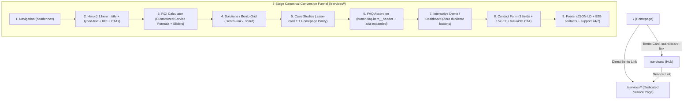

# Architectural Reference & Project Map: ai-avtopilot.ru

> **Status**: Production Hardened | **Updated**: 2026-10-01  
> **Live URL**: [https://ai-avtopilot.ru/](https://ai-avtopilot.ru/) | **Repo**: `Vlad-Voro/ai-avtopilot` (`main` - Private)  
> **Local Root**: `d:\AI\data\ai-avtopilot`  
> **Verification**: 131 / 131 PASS (83 E2E + 21 SEO + 13 Security + 14 Resiliency & Journey, 0 regressions)

---

## 1. Topology & Edge Infrastructure

```mermaid
flowchart TD
    Client["Client (Browser / Mobile / Tablet)"] -->|HTTPS / TLS 1.3 / Anycast IP 76.76.21.21| Vercel["Vercel Edge Network (Hobby Tier)"]

    subgraph EdgeLayer ["1. Edge & Routing Layer (Vercel + Cloudflare DNS)"]
        Vercel -->|1. Static Assets & HTML| VEdge["Vercel Anycast Edge (vercel.json)"]
        Vercel -->|2. POST /submit (Lead Ingestion)| CFW["Cloudflare Worker (ai-avtopilot-bot)"]
        VEdge -->|3. Security Headers + 1y Cache| VSec["HSTS, CSP, Frame Guard, Permissions-Policy"]
        VEdge -->|4. Deployment Isolation| VIgn[".vercelignore (blocks _headers, *.md, tests, bot)"]
    end

    subgraph AppLayer ["2. Static Hybrid Multi-Entry SSG"]
        VEdge --> P1["/ (Main Landing)"]
        VEdge --> P2["/services/ (1C / ERP / RPA Services)"]
        VEdge --> P3["/cases/ (340% Proven ROI Metrics)"]
        VEdge --> P4["/calculator/ (Interactive ROI Engine)"]
        VEdge --> P5["/dashboard/ (Real-Time Workload Simulator)"]
        VEdge --> P6["/faq/ (B2B FAQ: 1C/EDI/152-FZ)"]
        VEdge --> P7["/contact/ (Express Audit Capture)"]
    end

    subgraph LeadDelivery ["3. Resilient Ingestion & Notifications"]
        CFW -->|Primary: HTML Telegram API| TGB["Telegram Bot @AiAvtopilotbot"]
        TGB -->|Two-way routing| Admin["Duty Administrator"]
        CFW -.->|Fallback on network error| W3F["Web3Forms API + FormSubmit .co"]
        W3F -.-> Mail["contact@ai-avtopilot.ru"]
    end

    subgraph CICD ["4. Automated CI/CD Pipelines"]
        VDeploy["Vercel Git Integration"] -->|Push to main (Auto Deploy)| Vercel
        GHA["GitHub Actions (healthcheck.yml)"] -->|Synthetic Monitor (Daily & Push)| Vercel
    end
```

### 1.1. DNS & Edge Routing

- **Domain**: `ai-avtopilot.ru` (`.ru` TLD, registrar REG.RU).
- **Vercel Edge + Cloudflare DNS-Only (TSPU DPI Resilience)**:
  - Origin / Edge: Vercel Global Anycast Edge (`76.76.21.21`, zero 24KB stall in Russia).
  - Cloudflare Mode: **DNS only (Grey Cloud)** — serves authoritative DNS with DNSSEC without proxying, completely eliminating TSPU DPI throttling on Russian ISPs.
  - A record: `@` $\to$ `76.76.21.21` (DNS only).
  - CNAME record: `www` $\to$ `cname.vercel-dns.com` (DNS only, canonical 301 redirect to apex).
  - Webmaster Verification:
    - Google Search Console: DNS TXT `google-site-verification=u42j0jjBKadmyE77f9wlqfy5gkyDONXtaPzcPRZ51R8` + meta tag.
    - Yandex Webmaster: HTML verification file `/yandex_cd29b4304b5e16c6.html`.
- **Security & Caching (vercel.json & .vercelignore)**:
  - Custom 404 handler (`404.html` caught natively by Vercel for non-existent routes).
  - Sensitive file isolation via `.vercelignore`: blocks `_headers`, `*.md`, `tests/**`, `bot/**`, `cloudflare-worker/**`, `scripts/**`, `.htaccess`, `push_to_github.ps1`.
  - Clean URLs & Trailing Slash normalization configured in `vercel.json`.
  - Security headers enforced edge-wide: `X-Content-Type-Options: nosniff`, `X-Frame-Options: SAMEORIGIN`, `Referrer-Policy: strict-origin-when-cross-origin`, `Strict-Transport-Security: max-age=31536000; includeSubDomains; preload`, `Permissions-Policy`.
  - Static asset caching (`/assets/*` with `max-age=31536000, immutable`) and dynamic HTML revalidation (`public, max-age=0, must-revalidate`).
- **Mail Compliance**:
  - SPF: `v=spf1 include:_spf.mx.cloudflare.net ~all`.
  - DMARC: `_dmarc.ai-avtopilot.ru TXT "v=DMARC1; p=none; sp=none; aspf=r;"` (audit mode; avoids dropping legitimate mail).

---

## 2. Frontend Architecture & Design System

### 2.1. Zero-Blocking Delivery & Web Vitals (100/100 Mobile & Desktop)

- **Inlined Styles**: Global CSS embedded directly in `<head>` via `<style id="app-styles">` (~97 KB). Zero render-blocking external CSS.
- **WOFF2 Font Subsetting**: *Inter* (U+0400-045F Cyrillic, Latin) and *Outfit* preloaded via `<link rel="preload">`, partitioned into local Unicode ranges in `/assets/fonts/` with `font-display: swap`.
- **Core Web Vitals Thresholds**:
  - FCP: **0.3s – 0.5s**.
  - LCP: **0.5s – 0.6s**.
  - TBT: **0 ms**.
  - CLS: **0.000** (strict fixed heights on terminal, chart bars, and card containers).

### 2.2. Contrast & Palette (WCAG AA Strict)

- Background: `#050507` (Deep Cosmic Black).
- Text Tier 1 (`--text-1`): `#ffffff` (21:1 contrast).
- Text Tier 2 (`--text-2`): `#cbd5e1` (13.7:1 contrast on `#050507`).
- Text Tier 3 (`--text-3`): `#94a3b8` (7.9:1 contrast, exceeds WCAG AA 4.5:1).
- Accents: Indigo `--accent: #6366f1`, Purple `--accent-2: #a855f7`, Border glow `rgba(99, 102, 241, 0.25)`.
- Cards (`.scard`, `.case-card`, `.dash-card`): 4px hover elevation, `box-shadow: 0 12px 36px rgba(99, 102, 241, 0.18)`, neon border glow.

### 2.3. Breakpoints & Accessibility

- Viewport Grid: `1440px` (wide), `1200px` (desktop), `1024px` (tablet landscape), `768px` (tablet portrait), `414px / 375px / 320px` (mobile).
- Zero horizontal overflow (`overflow-x: clip / hidden` on body and wrapper containers).
- **Mobile Navigation**:
  - Burger touch target $\ge 48\text{px}$ with safe padding.
  - Synchronous `aria-expanded="true/false"`.
  - Body scroll lock (`overflow: hidden`) while open.
  - Auto-closes on `Escape` key or nav link selection.
- **Reduced Motion**: `@media (prefers-reduced-motion: reduce)` disables transforms, blinks, and particle animations.

---

## 3. Multi-Entry Hybrid SSG & Routing Engine

```text
index.html (Master Template)
   │
   ├── [sync_pages.py] ──> /services/index.html   (H1, Breadcrumbs, Canonical, Schema, Table, Mesh)
   ├── [sync_pages.py] ──> /cases/index.html      (H1, Breadcrumbs, Canonical, Schema, Table, Mesh)
   ├── [sync_pages.py] ──> /calculator/index.html (H1, Breadcrumbs, Canonical, Schema, Table, Mesh)
   ├── [sync_pages.py] ──> /dashboard/index.html  (H1, Breadcrumbs, Canonical, Schema, Table, Mesh)
   ├── [sync_pages.py] ──> /faq/index.html        (H1, Breadcrumbs, Canonical, Schema, FAQPage, Mesh)
   └── [sync_pages.py] ──> /contact/index.html    (H1, Breadcrumbs, Canonical, Schema, Form, Mesh)
```

### 3.1. SSG Generator (`scripts/sync_pages.py`)

- **Problem**: In static hosting environments without server-side rendering, direct deep navigation to sub-routes could trigger generic server 404s, degrading SEO indexation and UX.
- **Solution**: Multi-Entry Hybrid SSG:
  - 6 physical directories with dedicated `index.html`.
  - Unique `<title>`, `<meta description>`, OpenGraph, Twitter Cards, canonical `<link rel="canonical">`.
  - Exactly one `<h1>` per page reflecting page intent.
  - Zero phantom header banners (`subpage-deep` above the Hero is prohibited; Hero retains canonical full-height presentation).
  - PageRank Mesh (`.subpage-links-grid`) placed cleanly at the bottom of respective sections (`#services`, `#dashboard`, `#faq`, `#contact`) ensuring weight circulation without dead ends.
- **Build Command**:
  
  ```powershell
  python data/ai-avtopilot/scripts/sync_pages.py
  ```

### 3.2. Trailing Slash Normalization (Zero 301 Hops)

- All internal links in header, footer, mesh, and JS routing use trailing slashes: `/services/`, `/cases/`, `/calculator/`, `/dashboard/`, `/faq/`, `/contact/`.
- Configured at Edge level via `vercel.json` (`"trailingSlash": true`), automatically serving subpages with canonical trailing slash (308 redirect) while eliminating multi-hop protocol downgrades.

### 3.3. SOTA 404 Fallback & Custom Error Handling

- Native Vercel static error handling: automatically serves root `/404.html` on any non-existent route with 404 status.
- `404.html` branded with design system, catches non-existent URLs and provides immediate navigation back to core landing pages or SPA recovery.
- `index.html` router on `DOMContentLoaded` reads the stored path, restores clean URL via `history.replaceState`, and smooth scrolls to target with `scroll-margin-top: 80px`.

### 3.4. Deterministic ScrollSpy with Subpage Isolation (ADR 2026-10-01)

- Replaced flaky `IntersectionObserver` with DOM geometry-based `getActiveSection()` calculating active sections from scroll offset (`window.scrollY + offset`).
- Synchronously sets `.nav__link.active` on click, clears underline at `#home`.
- **Subpage Isolation Guard**: `const isSubpage = window.location.pathname.startsWith('/services') || document.querySelector('.subpage-deep')`. On subpages, `history.replaceState` is bypassed during scroll, strictly preserving the service URL structure (`/services/automated-reporting/`) and preventing SEO URL stripping.

---

## 4. Interactive Engines & Mathematical Models

### 4.1. ROI Calculator Model

- **Inputs**:
  - Employee count: $E \in [1, 100]$, step 1.
  - Routine hours/week per employee: $H \in [1, 40]$, step 1.
  - Average monthly salary: $S \in [30\,000, 300\,000]$ RUB, step $5\,000$ RUB.
- **Formulas**:
  - Routine fraction of month:
    $$D = \frac{H}{160}$$
  - Annual salary spent on routine:
    $$M = E \times S \times D \times 12$$
  - Annual savings (80% automation efficiency):
    $$W = M \times 0.80$$
  - Freed employee hours per year:
    $$X = E \times H \times 52$$
- **UI & Visualization**:
  - 7px track height, 999px rounded geometry.
  - Dynamic gradient fill via CSS var `--fill`:  
    `background: linear-gradient(to right, #6366f1 0%, #a855f7 pct%, rgba(255, 255, 255, 0.1) pct%, rgba(255, 255, 255, 0.1) 100%)`.
  - Pill badges displaying formatted current values and min/max limit ticks.

### 4.2. Hero Particle Canvas (CWV CPU/Battery Optimization)

- **Adaptive Density**:
  - Desktop ($\ge 768\text{px}$): 40 particles.
  - Mobile ($< 768\text{px}$): 18–20 particles (-75% CPU load, eliminates mobile thermal throttling).
- **Lifecycle Control**:
  - `IntersectionObserver` monitors Hero visibility.
  - `requestAnimationFrame` loop freezes when scrolled below Hero.
  - Resumes instantly when scrolled back into view.

### 4.3. Live Dashboard Simulator

- Real-time agent status simulation with log streams and metric bars (intervals: 3500ms and 2100ms).
- Linked to `visibilitychange`: when tab is inactive (`document.hidden === true`), intervals pause to eliminate memory leaks and background CPU cycles.

---

## 5. Edge Gateway, Cloudflare Worker & Ingestion

### 5.1. Cloudflare Worker Gateway (`cloudflare-worker/worker.js`)

Deploys on Cloudflare V8 isolates:

- **Endpoint**: `POST https://ai-avtopilot-bot.mr-vladimir-voronin.workers.dev/submit`.
- **Origin Whitelist**: Validates `Origin` header. Permitted:
  - `https://ai-avtopilot.ru`
  - `https://www.ai-avtopilot.ru`
  - `https://vlad-voro.github.io`
- **Sliding-Window Rate Limiter**: Max 5 requests per 10 minutes per IP with automatic stale IP pruning (>2000 entries).
- **Zero-Overhead Anti-Bot Defense**:
  - *Time-to-Submit*: Drops submissions faster than 1.0s (human input impossible under 1s).
  - *Interaction Tracker*: Enforces real user interaction events (`input`, `focus`, `touchstart`).
  - *Honeypot*: Hidden `_honey` field; non-empty values sink silently (HTTP 200 without Telegram dispatch).
- **Telegram HTML Sanitization**:
  - Allowed entities strictly: `&lt;`, `&gt;`, `&amp;`, `&quot;`.
  - Single quote escaping as `&#039;` is prohibited (causes `Telegram 400 Bad Request` and delivery drops).
- **Anti-Hijacking Reply Parser**:
  - Regex `^🆔 ID клиента: <code>(\d+)</code>` isolates real client ID, neutralizing injection in user quotes.

### 5.2. Resilient Lead Failover Cascade

1. **Primary**: POST to Cloudflare Worker $\to$ Telegram bot [@AiAvtopilotbot](https://t.me/AiAvtopilotbot) to duty admin.
2. **Timeout**: Client-side fetch aborted via `AbortController` after 6000ms.
3. **Secondary**: Web3Forms API $\to$ FormSubmit `.co` $\to$ inbox `contact@ai-avtopilot.ru`.
4. **Offline Fallback UI**: On catastrophic network failure, UI shows fallback card with 1-click clipboard payload copy and direct Telegram contact button.

### 5.3. Local Python Bot (`bot/bot.py`)

- Local development & backup gateway with proxy support (SOCKS5 `127.0.0.1:10808` / HTTP `127.0.0.1:10809`).
- Bi-directional relay: Admin native Telegram Replies route back to the originating client chat.

---

## 6. SEO, GEO & AEO (Generative Engine Optimization)

### 6.1. AI Search Crawlers (Yandex Neuro, ChatGPT, Perplexity)

- **Crawler Access (`robots.txt`)**: Explicitly allows 10 AI engines:
  - `GPTBot`, `OAI-SearchBot`
  - `PerplexityBot`
  - `ClaudeBot`
  - `Applebot-Extended`
  - `Amazonbot`, `Cohere-ai`, `Meta-ExternalAgent`, `Google-Extended`, `Yandex`
- **Machine-Readable Knowledge Context**:
  - `/llms.txt`: Dense summary of capabilities, stack, cases, and conversion contacts for fast RAG ingestion.
  - `/llms-full.txt`: Full technical protocol spec (1C OData REST API, Diadoc SDK, SBIS API, 152-FZ on-premise deployment).

### 6.2. Schema.org JSON-LD (@graph)

- `Organization` & `ProfessionalService`:
  - `currenciesAccepted: "RUB"`, `priceRange: "₽₽"`.
  - `paymentAccepted: "Bank transfer, cashless invoice, SBP"`.
  - `areaServed: "Russian Federation, Moscow"`.
  - `knowsAbout`: Taxonomies for AI Agents, RPA, 1C:ERP, 1C:UT, 1C:BP 3.0, 152-FZ.
- `FAQPage`: B2B accordion Q&A matching DOM elements 1:1.
- `BreadcrumbList`: Structural hierarchy across all 6 subpages.
- `WebSite`: Search intents and canonical domain.

### 6.3. Ad Parameter Sanitization (Yandex Clean-Param)

```txt
Clean-param: utm_source&utm_medium&utm_campaign&utm_content&utm_term&yclid&_openstat&from&vk_source&gclid&fbclid /
```

Prevents crawler index pollution and duplicate pages across 11 standard Russian ad tracking parameters.

---

## 7. Security & Zero-Trust Hardening

| Vector                      | Implementation                                                                                                              | Protection                                   |
| --------------------------- | --------------------------------------------------------------------------------------------------------------------------- | -------------------------------------------- |
| **OWASP Clickjacking**      | Inline Frame Guard in `<head>`: `if (self !== top) top.location = self.location;` with instant `body{display:none}` removal | Prevents malicious iframe embedding          |
| **Content Security Policy** | `default-src 'self'`; strict whitelists for `mc.yandex.ru`, Cloudflare Worker, Web3Forms, local fonts                       | Mitigates XSS and script injections          |
| **X-Content-Type-Options**  | `nosniff` meta tag & edge header                                                                                            | Disables browser MIME-type sniffing          |
| **Referrer Policy**         | `strict-origin-when-cross-origin`                                                                                           | Protects URL query privacy on outbound links |
| **Payload Clamping**        | Max 10 KB request body, length validation on inputs                                                                         | Prevents Telegram 400 DoS attacks            |
| **Secrets Hygiene**         | Zero plaintext tokens in repository; secrets managed via Cloudflare Worker environment                                      | Eliminates credential leak vectors           |

---

## 8. Verification Matrix: 131 Automated Tests & Synthetic Healthcheck

```powershell
# 1. Full Master Suite (131 checks: 83 E2E + 21 SEO + 13 Security + 14 Resiliency & Journeys)
node data/ai-avtopilot/tests/run_all.js

# 2. 83 E2E Browser tests (Rendering, responsive, routing, math, user journeys)
node data/ai-avtopilot/tests/run_e2e_tests.js

# 3. 21 Technical & SEO tests (Directives, canonicals, OfferCatalog, PageRank mesh, H1)
node data/ai-avtopilot/tests/seo/test_seo_audit.js

# 4. 13 Edge Security tests (Worker gateway, sanitization, anti-bot, clickjack)
node data/ai-avtopilot/tests/security/test_security_audit.js

# 5. 14 Resiliency, Forms & JTBD tests (AbortController, fallback UI, anti-slop, lead delivery)
node data/ai-avtopilot/tests/resiliency/test_resiliency_jtbd.js
```

### Synthetic Monitoring & CI/CD Gate

- **Daily Cron & Push Verification**: `.github/workflows/healthcheck.yml` executes SEO, Security, Resiliency suites, and live HTTP 200 ping.

### 4-Tier E2E Architecture (83 tests, 3-worker context pool, ~16s runtime)

- **Tier 1 (Feature Coverage R1–R7, 44 tests)**: Hero layout, section sequence, WCAG AA contrast, bento/card hover, slash routing, slider 7px track/math, fixed CLS heights, visibility lifecycle, passive listeners.
- **Tier 2 (Boundary & Corner Cases, 28 tests)**: 8 viewports (320px..2560px), slider extremes (Min 1/1/30k, Max 100/40/300k, Mid), rapid input drag (50 iterations), SPA 404 fallback, burger 10x toggle, ESC close, rapid nav clicks.
- **Tier 3 (Cross-Feature Interactions, 6 tests)**: Scroll during nav click, mobile slider drag without horizontal shift, scroll lock during open menu, hash/pushState transitions.
- **Tier 4 (Real-World User Journeys, 5 tests)**: Full workflows: first-time visitor discovery, bento exploration, CFO ROI calculation, direct deep-link `/cases/`, mobile lead submission on 375px.

---

## 9. B2B Commercial Model & Positioning

### 9.1. Core Offer & Landing Triggers

- **Hero Offer**: **"Free 30-minute express audit of 3 business processes"**.
- **Value Proposition**: Selling **direct payroll reduction, cash gap elimination, and inventory mismatch prevention**, not abstract "AI/neural nets".
- **Pilot Framework**: 14-day fixed pilot.

### 9.2. Decision Maker Personas (B2B)

1. **Chief Operating Officer (COO)**: Stock accuracy, marketplace overstock/out-of-stock (WB/Ozon), order fulfillment delays.
2. **Chief Financial Officer / Chief Accountant (CFO)**: Month-end close delays (3–5 days), invoice backlogs in EDI (Diadoc/SBIS), manual reconciliations.
3. **Chief Information Officer (CIO / CTO)**: Shortage of 1C developers, 1C OData REST API integration, 152-FZ on-premise compliance.
4. **Business Owner / CEO**: Scaling operational capacity without expanding back-office headcount.

---

## 10. Canonical Specification & Generation Manifest for Service Landing Pages (`/services/<slug>/`)

> **Golden Standard (Эталон)**: Every service subpage in the `/services/` cluster must be built as an autonomous, high-converting standalone landing page mirroring the visual excellence, typography, interactive fidelity, and strict SEO compliance of the root homepage (`index.html`).



### 10.1. Architecture, Placement & SEO Hierarchy

1. **File System Location**: Dedicated subfolder `services/<slug>/index.html` (e.g., [`services/automated-reporting/index.html`](file:///d:/AI/data/ai-avtopilot/services/automated-reporting/index.html)).
2. **Canonical & URL Normalization**:
   - Canonical link: `<link rel="canonical" href="https://ai-avtopilot.ru/services/<slug>/" />`.
   - Trailing slash strict: `/services/<slug>/` (never `/services/<slug>` or root `/automated-reporting/`).
   - BreadcrumbList Schema.org: `Главная (/)` $\to$ `Услуги (/services/)` $\to$ `<Название услуги> (/services/<slug>/)`.
3. **Homepage & Hub Bento Integration**:
   - On `index.html` and `services/index.html`, the promo card for this service MUST be wrapped entirely as an accessible clickable block:
     `<a href="/services/<slug>/" class="scard scard--link" role="group" aria-roledescription="slide" aria-label="<Название>: подробнее...">`
   - Include arrow indicator `<span class="scard__arrow" aria-hidden="true">→</span>` in `<h3>`.
   - Maintain strict vertical height parity with sibling cards (e.g. Card 1 "Интеграция систем" and Card 2 "Автоотчётность") via identical padding, copy length, and bottom badge tags (`<div class="scard__tags"><span>...</span></div>`).

### 10.2. DOM Conversion Funnel Specifications

| Section | Component | Mandatory Architecture & Styling Rules |
| :--- | :--- | :--- |
| **1. Nav** | `header.nav#site-header` | Clean logo link to `/`, navigation links to `/calculator/`, `/services/`, `/cases/`, `/faq/`, `/dashboard/`, `/contact/`, mobile burger button ($\ge 48\text{px}$). |
| **2. Hero** | `section.hero#home` | **Exactly ONE `<h1>` per page**: `<h1 class="hero__title"><span class="hero__title-static">...</span><span class="hero__title-accent-box"><span class="hero__title-accent" data-phrases='["...", "..."]' id="typed-text">...</span><span class="hero__cursor" aria-hidden="true">\|</span></span></h1>`. Particles canvas, KPI counter cards, Primary CTA (`href="#contact"`), Ghost CTA (`href="#dashboard"`). |
| **3. ROI Calculator** | `section.roi#calculator` | Tailored to service economics (e.g., Analysts $\times$ Hours compiling reports $\times$ Salary). Reactive JS slider listeners updating `--fill` gradient, formatted numerical labels, zero `NaN`, guaranteed 80% savings math. |
| **4. Bento Grid** | `section.services#services` | Bento grid of specific service features / modules (`.scard`, `.scard--wide`, `.scard--dark`, `.scard--accent`), tags, hover elevation. PageRank mesh (`.subpage-links-grid`) at section bottom. |
| **5. Case Studies** | `section.cases#cases` | **1:1 Homepage Parity**: Direct children inside `.case-card` (prohibited: intermediate wrapper `<div>`s that collapse `gap: 20px`), `.case-highlight`, metric pills (`2 ч`, `0`, `4.2 млн ₽`, `340%`), `.case-card__results`. |
| **6. FAQ** | `section.faq#faq` | Semantic accordion with `<button class="faq-item__header" aria-expanded="false" type="button">`, domain-specific B2B answers (1C, security 152-FZ, SLA, NDA). Single `<h2>` section title. |
| **7. Interactive Demo** | `section.dashboard#dashboard` | Live terminal and agent telemetry cards. **Zero duplicate CTA buttons** (prohibited: extra audit button inside `#dashboard` card). |
| **8. Contact Form** | `section.contact#contact` | Canonical 3-field layout: Name (`#contact-name`, required), Company (`#contact-company`, optional), Contact (`#contact-email`, required). 152-FZ consent, Honeypot `_honey`, single full-width CTA `<button type="submit" class="btn btn--primary btn--full" id="form-submit">`. |
| **9. Footer** | `footer.footer` | Telegram bot `@AiAvtopilotbot`, email `contact@ai-avtopilot.ru`, 24/7 support hours, JSON-LD Schema graph. |

### 10.3. Strict Prohibitions & Anti-Patterns (Negative Invariants)

1. ❌ **Zero Phantom Top Banners**: Prohibited to inject `subpage-deep` boxes above the Hero section at `<main id="main-content">`. Subpages must start with Hero immediately after Navigation.
2. ❌ **Zero ScrollSpy URL Hijacking**: On subpages (`/services/*`), ScrollSpy must NEVER overwrite `window.location.pathname` via `history.replaceState` when scrolling between sections.
3. ❌ **Zero H1 Pollution**: Every page must have exactly ONE `<h1>` tag located in the Hero title. Prohibited to have 0 or $>1$ H1s.
4. ❌ **Zero Flex Wrapper Pollution**: Prohibited to wrap `.case-card` or `.scard` content in arbitrary `<div>` containers that break `display: flex; flex-direction: column; gap: 20px; .case-card__desc { flex: 1; }`.
5. ❌ **Zero Duplicate CTA Buttons**: Prohibited to duplicate audit buttons inside demo widgets or intermediate cards.
6. ❌ **Zero Extra Form Fields**: Prohibited to introduce unstyled `<select>` elements, radio buttons, or non-standard inputs into the canonical lead capture form.
7. ❌ **Zero Incomplete Sliders**: Prohibited to output static or broken calculator sliders without reactive JS bindings and gradient `--fill` updates.
8. ❌ **Zero Duplicate Event Listeners & Script Collision**: Never re-attach inline script listeners for components already wired in the master bundle `index-Bx30wa4i.js` (Hero typewriter `#typed-text`, FAQ accordion `.faq-item__header`, ROI sliders, Nav burger, Modals). Duplicate listeners cause instant cancellation / double-toggle bugs (e.g. FAQ opening and immediately closing on click).
9. ❌ **Zero Typewriter Phrase Wrapping & Hero Jitter**: All phrases in `data-phrases` for `#typed-text` MUST be compact ($\le 26$ characters) to guarantee 1-line display inside `.hero__title-accent-box` with explicit `min-height: 1.2em` / `2.4em`, eliminating multi-line reflow and layout shift (CLS).
10. ❌ **Zero Calculator Math Divergence**: Sliders `#slider-employees`, `#slider-hours`, `#slider-salary` must adhere strictly to the core mathematical contract ($E \times S \times \frac{H}{160} \times 12$ annual routine cost, $80\%$ savings, $E \times H \times 52$ routine hours) and canonical IDs (`#roi-cost`, `#roi-save`, `#roi-hours`) with valid Russian locale currency formatting.
11. ❌ **Zero Static SSR Terminal Stubs**: Telemetry terminals, live logs, and KPI badge values must be pre-rendered in SSR HTML to avoid empty layout boxes or FOUC before client JS execution.
12. ❌ **Zero Navigation Link Hijacking on Subpages**: On standalone subpages (`/services/*`), clicking header/footer absolute routes (`/services/`, `/cases/`, `/calculator/`, `/`, etc.) MUST trigger genuine browser navigation to the target page, never trapping the user in-place or faking the URL without updating content.
13. ❌ **Zero Log Overflow & Text Clipping**: Telemetry event logs (`#analytics-event-log`, `#reporting-event-log`) must strictly use semantic `.log-item` (`font-size: 0.72rem`, `gap: 10px`) with `.log-item__time` and `.log-item__text` to guarantee zero horizontal text cutoff across all device widths.
14. ❌ **Universal Swipe Carousel Nudge**: All horizontally scrollable blocks (`.services__bento`, `.cases__grid`) on mobile/tablet ($\le 1024\text{px}$) must be registered in the shared GPU nudge observer (`@keyframes sNudge`) to visually demonstrate horizontal swipeability on initial viewport entry.

### 10.4. Single-Prompt Generation Protocol (`/plan`)

When generating or scaling a new service page via a single `/plan` prompt:
1. **Copywriting Phase**: Draft hardcore B2B copy with concrete enterprise integrations (1C OData, Diadoc SDK, SBIS, P&L, DDS, 14-day pilot, SLAs).
2. **Template Synthesis**: Use [`scripts/build_reporting_page.py`](file:///d:/AI/data/ai-avtopilot/scripts/build_reporting_page.py) as reference engine to clone master styles, layout, and scripts without CSS drift.
3. **Interactive Calibrations**: Adapt typewriter `data-phrases` ($\le 26$ chars) and standard ROI calculator labels while leveraging master bundle events.
4. **Bento Interlinking**: Update `index.html` and `services/index.html` with `.scard.scard--link` pointing to `/services/<new-slug>/`.
5. **Validation Gate**: Run `node tests/run_all.js` (all 131 tests MUST pass 100% green before push).
