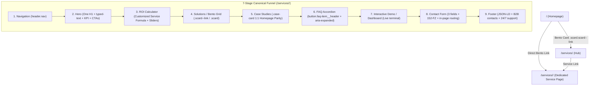

# Architectural Reference & Production Blueprint: ai-avtopilot.ru

> **Status**: Production Hardened | **Updated**: 2026-10-01  
> **Live URL**: [https://ai-avtopilot.ru/](https://ai-avtopilot.ru/) | **Repo**: `Vlad-Voro/ai-avtopilot` (`main` - Private)  
> **Local Root**: `d:\AI\data\ai-avtopilot`  
> **Verification Matrix**: **137 / 137 PASS** (84 E2E + 21 SEO + 13 Security + 19 Resiliency & Journeys, 0 regressions)

---

## 1. Edge Infrastructure & Network Topology

```mermaid
flowchart TD
    Client["Client Browser"] -->|HTTPS / TLS 1.3 / Anycast 76.76.21.21| Vercel["Vercel Edge Network (Hobby Tier)"]

    subgraph EdgeLayer ["1. Edge & DNS Layer (Vercel + Cloudflare Grey Cloud)"]
        Vercel -->|1. Static Assets & Subpages| VEdge["Vercel Anycast Edge (vercel.json)"]
        Vercel -->|2. POST /submit (Lead Ingestion)| CFW["Cloudflare Worker (ai-avtopilot-bot)"]
        VEdge -->|3. Security Headers + 1y Cache| VSec["HSTS, CSP, Frame Guard, Permissions-Policy"]
        VEdge -->|4. Deployment Isolation| VIgn[".vercelignore (blocks _headers, *.md, tests, bot)"]
    end

    subgraph AppLayer ["2. Multi-Entry Hybrid SSG"]
        VEdge --> P1["/ (Main Landing)"]
        VEdge --> P2["/services/ (Hub & Cluster)"]
        VEdge --> P3["/cases/ (Hub & Cluster)"]
        VEdge --> P4["/calculator/ (ROI Engine)"]
        VEdge --> P5["/dashboard/ (Telemetry Simulator)"]
        VEdge --> P6["/faq/ (B2B Accordion)"]
        VEdge --> P7["/contact/ (Express Audit Capture)"]
    end

    subgraph Ingestion ["3. Resilient Ingestion & Notifications"]
        CFW -->|Primary: HTML Telegram API| TGB["Telegram Bot @AiAvtopilotbot"]
        TGB --> Admin["Duty Administrator"]
        CFW -.->|Fallback on network error| W3F["Web3Forms + FormSubmit.co"]
        W3F -.-> Mail["contact@ai-avtopilot.ru"]
    end

    subgraph Monitoring ["4. Synthetic CI/CD Monitoring"]
        GHA["GitHub Actions (healthcheck.yml)"] -->|Daily Cron + Push Verification| Vercel
    end
```

### 1.1. DNS, Routing & Anti-Throttling (TSPU DPI Resilience)
- **Apex & Subdomains**: `ai-avtopilot.ru` (REG.RU registrar).
  - A `@` $\to$ `76.76.21.21` (Vercel Global Anycast Edge; zero 24KB DPI stall in Russia).
  - CNAME `www` $\to$ `cname.vercel-dns.com` (canonical 301 redirect to apex).
  - Cloudflare Mode: **DNS only (Grey Cloud)** + **DNSSEC** (DS 2371). Bypasses Russian TSPU DPI throttling on Cloudflare proxies.
- **Webmaster Ownership**:
  - Google Search Console: DNS TXT `google-site-verification=u42j0jjBKadmyE77f9wlqfy5gkyDONXtaPzcPRZ51R8` + meta tag.
  - Yandex Webmaster: HTML verification file `/yandex_cd29b4304b5e16c6.html` (HTTP 200, cleanUrls bypassed for verification).
- **Security & Caching Rules (`vercel.json`)**:
  - Trailing slash normalization: `"trailingSlash": true` (canonical 308 redirect, zero multi-hop downgrades).
  - Static assets: `/assets/*` $\to$ `Cache-Control: public, max-age=31536000, immutable`.
  - HTML documents: `Cache-Control: public, max-age=0, must-revalidate`.
  - Isolation via `.vercelignore`: blocks `_headers`, `*.md`, `tests/**`, `bot/**`, `cloudflare-worker/**`, `scripts/**`, `.htaccess`, `push_to_github.ps1`.
  - Security headers: `X-Content-Type-Options: nosniff`, `X-Frame-Options: SAMEORIGIN`, `Referrer-Policy: strict-origin-when-cross-origin`, `Strict-Transport-Security: max-age=31536000; includeSubDomains; preload`, `Permissions-Policy`.
- **Mail Authentication**:
  - SPF: `v=spf1 include:_spf.mx.cloudflare.net ~all`.
  - DMARC: `_dmarc.ai-avtopilot.ru TXT "v=DMARC1; p=none; sp=none; aspf=r;"`.

---

## 2. Frontend Architecture & Design System

### 2.1. Web Vitals & Zero-Blocking Engine
- **Inlined CSS**: Master stylesheet embedded directly in `<head>` via `<style id="app-styles">` (~97 KB). Zero render-blocking external stylesheets.
- **Font Subsetting**: Local WOFF2 fonts (*Inter* Cyrillic/Latin, *Outfit* headings) preloaded via `<link rel="preload">` in `/assets/fonts/` with `font-display: swap`.
- **CWV Targets**: FCP 0.3s–0.5s | LCP 0.5s–0.6s | TBT 0 ms | CLS 0.000 (fixed dimensions on terminals, sliders, and bento cards).

### 2.2. Strict Palette & Contrast (WCAG AA Compliant)
- Background: `#050507` (Deep Cosmic Black).
- Text Tier 1 (`--text-1`): `#ffffff` (21:1 contrast).
- Text Tier 2 (`--text-2`): `#cbd5e1` (13.7:1 contrast on `#050507`).
- Text Tier 3 (`--text-3`): `#94a3b8` (7.9:1 contrast, exceeds WCAG AA 4.5:1).
- Accents: Indigo `--accent: #6366f1`, Purple `--accent-2: #a855f7`, Border glow `rgba(99, 102, 241, 0.25)`.
- Cards (`.scard`, `.case-card`, `.dash-card`): 4px hover elevation, `box-shadow: 0 12px 36px rgba(99, 102, 241, 0.18)`.

### 2.3. Breakpoints & Accessibility
- Viewports: `1440px`, `1200px`, `1024px`, `768px`, `414px`, `375px`, `320px`. Zero horizontal overflow (`overflow-x: clip / hidden`).
- Mobile Navigation: Touch target $\ge 48\text{px}$, synchronous `aria-expanded`, body scroll lock (`overflow: hidden`), auto-close on `Escape` or nav link click.
- Motion Sensitivity: `@media (prefers-reduced-motion: reduce)` disables particles, transforms, and pulsating glows.

---

## 3. Multi-Entry Hybrid SSG & Navigation Engine

```text
index.html (Master Template)
   │
   ├── [sync_pages.py] ──> /services/index.html   (H1, Breadcrumbs, Canonical, Schema, Bento Mesh)
   ├── [sync_pages.py] ──> /cases/index.html      (H1, Breadcrumbs, Canonical, Schema, Case Mesh)
   ├── [sync_pages.py] ──> /calculator/index.html (H1, Breadcrumbs, Canonical, Schema, ROI Sliders)
   ├── [sync_pages.py] ──> /dashboard/index.html  (H1, Breadcrumbs, Canonical, Schema, Live Demo)
   ├── [sync_pages.py] ──> /faq/index.html        (H1, Breadcrumbs, Canonical, Schema, FAQPage)
   └── [sync_pages.py] ──> /contact/index.html    (H1, Breadcrumbs, Canonical, Schema, Lead Form)
```

- **SSG Synchronization**:
  ```powershell
  python data/ai-avtopilot/scripts/sync_pages.py
  ```
- **SOTA 404 Fallback**: Root `/404.html` caught natively by Vercel; preserves original request path, executes client-side `history.replaceState`, and restores target state without broken redirects.
- **Deterministic ScrollSpy & Subpage Isolation (ADR 2026-10-01)**:
  - Active section calculated deterministically via DOM geometry (`getActiveSection()`) based on scroll offset (`window.scrollY + offset`).
  - Clears active underline on `#home`.
  - **Subpage Isolation Guard**: `const isSubpage = window.location.pathname.startsWith('/services') || document.querySelector('.subpage-deep')`. Bypasses `history.replaceState` during scroll on subpages, preserving clean URLs (`/services/system-integration/`) and preventing SEO stripping.

---

## 4. Interactive Engines & Mathematical Contracts

### 4.1. ROI Calculator Exact Specifications
- **Input Boundaries**:
  - Employee count: $E \in [1, 100]$, step 1.
  - Routine hours/week per employee: $H \in [1, 40]$, step 1.
  - Average monthly salary: $S \in [30\,000, 300\,000]$ RUB, step $5\,000$ RUB.
- **Formulas**:
  $$\text{Routine Fraction: } D = \frac{H}{160}$$
  $$\text{Annual Routine Cost: } M = E \times S \times D \times 12$$
  $$\text{Annual Savings (80% Efficiency): } W = M \times 0.80$$
  $$\text{Freed Hours Per Year: } X = E \times H \times 52$$
- **UI & Slider Implementation**:
  - Track: 7px height, 999px border-radius.
  - CSS Dynamic Gradient Fill:
    `background: linear-gradient(to right, #6366f1 0%, #a855f7 pct%, rgba(255, 255, 255, 0.1) pct%, rgba(255, 255, 255, 0.1) 100%)`.
  - Canonical Output IDs: `#roi-cost`, `#roi-save`, `#roi-hours` formatted via Russian currency locale (`ru-RU`).

### 4.2. Hero Particle Canvas (CPU & Battery Guard)
- **Density**: Desktop ($\ge 768\text{px}$) 40 particles; Mobile ($< 768\text{px}$) 18–20 particles (-75% CPU load).
- **Lifecycle**: `IntersectionObserver` halts `requestAnimationFrame` loop when Hero leaves viewport; resumes instantly on re-entry.

### 4.3. Live Dashboard Telemetry Simulator
- Simulated telemetry streams (intervals: 3500ms and 2100ms).
- Pauses execution during inactive browser tabs via `visibilitychange` (`document.hidden === true`), eliminating background CPU and memory leaks.

---

## 5. Ingestion Gateway, Edge Security & Anti-Bot Defense

### 5.1. Cloudflare Worker Gateway (`cloudflare-worker/worker.js`)
- **Endpoint**: `POST https://ai-avtopilot-bot.mr-vladimir-voronin.workers.dev/submit`.
- **Whitelisted Origins**: `https://ai-avtopilot.ru`, `https://www.ai-avtopilot.ru`, `https://vlad-voro.github.io`.
- **Sliding-Window Rate Limiting**: Max 5 requests per 10 minutes per IP with automatic stale IP pruning (>2000 records).
- **Zero-Overhead Anti-Bot Defense**:
  - *Time-to-Submit*: Drops submissions completed under 1.0s (inhuman speed).
  - *User Interaction Tracker*: Validates client interaction events (`input`, `focus`, `touchstart`).
  - *Honeypot*: Hidden field `_honey`; non-empty submissions return HTTP 200 silently without Telegram dispatch.
- **Telegram HTML Sanitization**:
  - Allowed entities: strictly `&lt;`, `&gt;`, `&amp;`, `&quot;`.
  - **Prohibited `&#039;`**: Escaping single quotes as `&#039;` triggers `Telegram 400 Bad Request` and drops leads.
- **Anti-Hijacking Reply Parser**: Regex `^🆔 ID клиента: <code>(\d+)</code>` isolates client ID, preventing prompt injection in user quotes.

### 5.2. Lead Failover Cascade
1. **Primary**: Worker $\to$ Telegram bot [@AiAvtopilotbot](https://t.me/AiAvtopilotbot) to duty administrator.
2. **Timeout**: Fetch aborted via `AbortController` after 6000ms.
3. **Secondary**: Web3Forms API $\to$ FormSubmit.co $\to$ `contact@ai-avtopilot.ru`.
4. **Offline Fallback UI**: On catastrophic network failure, UI shows fallback card with 1-click clipboard payload copy and direct Telegram contact button.

---

## 6. SEO, GEO & AEO (Generative Search Optimization)

### 6.1. Search Engine & AI Crawler Directives (`robots.txt`)
- Explicitly permits 10 AI crawler bots: `GPTBot`, `OAI-SearchBot`, `PerplexityBot`, `ClaudeBot`, `Applebot-Extended`, `Amazonbot`, `Cohere-ai`, `Meta-ExternalAgent`, `Google-Extended`, `Yandex`.
- Ad tracking URL deduplication:
  ```txt
  Clean-param: utm_source&utm_medium&utm_campaign&utm_content&utm_term&yclid&_openstat&from&vk_source&gclid&fbclid /
  ```
- Fast RAG Machine Context: `/llms.txt` and `/llms-full.txt` (1C OData, Diadoc SDK, SBIS, 152-FZ on-premise).

### 6.2. Schema.org JSON-LD (@graph)
- `Organization` & `ProfessionalService`: RUB currency, areaServed "Russian Federation, Moscow", 152-FZ taxonomies.
- `FAQPage`: B2B questions matching DOM accordion 1:1.
- `BreadcrumbList`: Structural 3-tier hierarchy across all subpages.
- `TechArticle`: Deep metadata for dedicated case study pages.

---

## 7. Security & Zero-Trust Hardening

| Vector | Implementation | Protection |
| :--- | :--- | :--- |
| **OWASP Clickjacking** | Inline `<head>` guard: `if (self !== top) top.location = self.location;` with instant `body{display:none}` removal | Blocks malicious iframe embedding |
| **Content Security Policy** | `default-src 'self'`; whitelist for `mc.yandex.ru`, Cloudflare Worker, Web3Forms, local fonts | Mitigates XSS and script injections |
| **X-Content-Type-Options** | `nosniff` meta tag & edge header | Prevents MIME-type sniffing |
| **Referrer Policy** | `strict-origin-when-cross-origin` | Protects URL parameter privacy on outbound links |
| **Payload Clamping** | Max 10 KB request body, length validation on all inputs | Prevents buffer and DoS attacks |
| **Secrets Hygiene** | Zero tokens in repository; credentials managed in Cloudflare Worker environment | Prevents secret leaks |

---

## 8. Verification Matrix: 137 Automated Checks

```powershell
# Master Test Suite (137 checks: 84 E2E + 21 SEO + 13 Security + 19 Resiliency & Journeys)
node data/ai-avtopilot/tests/run_all.js

# Individual Test Suites:
node data/ai-avtopilot/tests/run_e2e_tests.js                 # 84 E2E Browser checks
node data/ai-avtopilot/tests/seo/test_seo_audit.js           # 21 Technical & Semantic SEO checks
node data/ai-avtopilot/tests/security/test_security_audit.js # 13 Edge Security checks
node data/ai-avtopilot/tests/resiliency/test_resiliency_jtbd.js # 19 Resiliency, Form & Journey checks
```

- **Tier 1 (Feature Coverage R1–R7, 44 tests)**: Layout, contrast WCAG AA, bento hover, 7px slider track, CLS fixed heights, lifecycle observers.
- **Tier 2 (Boundary & Corner Cases, 28 tests)**: 8 viewports (320px..2560px), slider extremes (Min/Max/Mid), 50 drag stress iterations, 404 SPA fallback, burger toggles.
- **Tier 3 (Cross-Feature Interactions, 6 tests)**: Scroll during nav click, mobile slider drag, scroll lock, hash/pushState transitions.
- **Tier 4 (Real-World User Journeys, 5 tests)**: First-time visitor, bento exploration, CFO calculation, direct deep-link `/cases/`, mobile lead submission on 375px.
- **Tier 5 (Services Cluster E2E, 6 tests)**: Bento cross-linking, zero mobile overflow (320px), slider reactivity, accordion open/close, semantic DOM.

---

## 9. Canonical Specification for Service Landing Pages (`/services/<slug>/`)

> **Standard**: Every service subpage in `/services/` is an autonomous standalone landing page mirroring the visual excellence, typography, interactive fidelity, and strict SEO compliance of `index.html`.



### 9.1. DOM Funnel Specifications
| Section | Component | Mandatory Architecture & Styling Rules |
| :--- | :--- | :--- |
| **1. Nav** | `header.nav#site-header` | Logo link to `/`, navigation links to `/calculator/`, `/services/`, `/cases/`, `/faq/`, `/dashboard/`, `/contact/`, burger ($\ge 48\text{px}$). |
| **2. Hero** | `section.hero#home` | **Exactly ONE `<h1>`**: `<h1 class="hero__title"><span class="hero__title-static">...</span><span class="hero__title-accent-box"><span class="hero__title-accent" data-phrases='["...", "..."]' id="typed-text">...</span><span class="hero__cursor" aria-hidden="true">\|</span></span></h1>`. Particle canvas, KPI counter cards, Primary CTA (`href="#contact"`), Accent Secondary CTA (`href="#dashboard"`). |
| **3. ROI Calculator** | `section.roi#calculator` | Reactive JS sliders updating `--fill` gradient, formatted numerical labels, zero `NaN`, 80% savings math. |
| **4. Bento Grid** | `section.services#services` | Bento feature modules (`.scard`, `.scard--wide`, `.scard--dark`, `.scard--accent`), tags, hover elevation. PageRank mesh (`.subpage-links-grid`) at section bottom. |
| **5. Case Studies** | `section.cases#cases` | Direct children inside `.case-card` (no intermediate wrappers), `.case-highlight`, metric pills (`2 ч`, `0`, `4.2 млн ₽`, `340%`). |
| **6. FAQ** | `section.faq#faq` | Semantic accordion `<button class="faq-item__header" aria-expanded="false" type="button">`, B2B answers (1C, 152-FZ, SLA, NDA). |
| **7. Interactive Demo** | `section.dashboard#dashboard` | Live terminal and agent telemetry. Zero duplicate CTA buttons inside dashboard widget. |
| **8. Contact Form** | `section.contact#contact` | Canonical 3 fields: Name (`#contact-name`), Company (`#contact-company`), Contact (`#contact-email`). 152-FZ consent, Honeypot `_honey`, full-width CTA button. In-page smooth scroll anchor. |
| **9. Footer** | `footer.footer` | Telegram bot `@AiAvtopilotbot`, email `contact@ai-avtopilot.ru`, 24/7 support hours, JSON-LD Schema graph. |

### 9.2. Strict Negative Invariants & Incident Learnings (16 Rules)
1. ❌ **Zero Phantom Top Banners**: Prohibited to inject `subpage-deep` boxes above Hero; pages must start with Hero immediately after Navigation.
2. ❌ **Zero ScrollSpy URL Hijacking**: On subpages (`/services/*`), `history.replaceState` must NEVER overwrite URL when scrolling between sections (`isSubpage` guard).
3. ❌ **Zero H1 Pollution**: Exactly ONE `<h1>` tag located in the Hero title. Prohibited to have 0 or $>1$ H1s.
4. ❌ **Zero Flex Wrapper Pollution**: Prohibited to wrap `.case-card` or `.scard` content in intermediate `<div>` wrappers that break flex layout.
5. ❌ **Zero Duplicate CTA Buttons**: Prohibited to duplicate audit buttons inside demo widgets or intermediate cards.
6. ❌ **Zero Extra Form Fields**: Prohibited to introduce unstyled `<select>` elements, radio buttons, or non-standard inputs into the lead form.
7. ❌ **Zero Incomplete Sliders**: Prohibited to output static sliders without reactive JS bindings and gradient `--fill` updates.
8. ❌ **Zero Duplicate Event Listeners**: Never re-attach inline script listeners for components already wired in `index-Bx30wa4i.js` (`#typed-text`, `.faq-item__header`, ROI sliders, burger). Duplicate listeners cause instant cancellation / double-toggle bugs.
9. ❌ **Zero Typewriter Phrase Wrapping & Hero Jitter**: All phrases in `data-phrases` for `#typed-text` MUST be $\le 26$ characters with explicit `min-height: 1.2em`, eliminating multi-line reflow and layout shift (CLS).
10. ❌ **Zero Calculator Math Divergence**: Sliders must adhere strictly to the core mathematical contract ($E \times S \times \frac{H}{160} \times 12$, $80\%$ savings, $E \times H \times 52$) and canonical IDs (`#roi-cost`, `#roi-save`, `#roi-hours`).
11. ❌ **Zero Static SSR Terminal Stubs**: Telemetry terminals, live logs, and KPI badge values must be pre-rendered in SSR HTML.
12. ❌ **Zero Navigation Link Hijacking on Subpages**: Absolute routes (`/services/`, `/cases/`, `/calculator/`, `/`) MUST trigger genuine browser navigation, never trapping the user in-place.
13. ❌ **Zero Log Overflow & Text Clipping**: Telemetry logs must strictly use `.log-item` (`font-size: 0.72rem`, `gap: 10px`) with `.log-item__time` and `.log-item__text`.
14. ❌ **Universal Swipe Carousel Nudge**: All horizontally scrollable blocks (`.services__bento`, `.cases__grid`) on mobile/tablet ($\le 1024\text{px}$) must include the GPU nudge observer (`@keyframes sNudge`).
15. ❌ **Zero Factoid Sheet Clutter (Incident 2026-10-01)**: Prohibited to inject standalone factoid sheet cards into the DOM. Embed direct answer facts into Hero subtitle, FAQ, and Schema.org.
16. ❌ **Subpage In-Page Form Routing (Incident 2026-10-01)**: Secondary CTAs with `href="#contact"` must smoothly anchor-scroll to the in-page contact form; form layout uses 2 columns on desktop, 1 column on mobile.

---

## 10. Canonical Specification for Case Study Landing Pages (`/cases/<slug>/`)

> **Standard**: Every dedicated case study subpage in `/cases/` is an autonomous standalone landing page highlighting hard ROI metrics, real 1C/ERP architectural workflows, and 152-FZ on-premise security.

```mermaid
flowchart TD
    Index["/ (Homepage)"] -->|Case Card .case-card--link| CasePage["/cases/<slug>/ (Dedicated Case Page)"]
    Hub["/cases/ (Hub)"] -->|Mesh / Case Link| CasePage
    
    subgraph CaseStructure ["Canonical Case Study Conversion Flow (/cases/<slug>/)"]
        C1["1. Navigation (header.nav)"]
        C2["2. Hero (H1 + 3 Hard KPI Cards + CTAs)"]
        C3["3. ROI Calculator (Industry Pre-calibrated Sliders)"]
        C4["4. Compare (Problem 'Было' vs Autopilot 'Стало')"]
        C5["5. Solutions / Bento Architecture (.scard modules)"]
        C6["6. FAQ Accordion (152-FZ, 1C CFE extensions, SLA)"]
        C7["7. Live Telemetry & Log Simulator (#dashboard)"]
        C8["8. Other Case Studies (#cases 'Другие кейсы' at bottom)"]
        C9["9. Contact Form (Canonical 3-field layout)"]
        C10["10. Footer (JSON-LD + 24/7 support)"]
        
        C1 --> C2 --> C3 --> C4 --> C5 --> C6 --> C7 --> C8 --> C9 --> C10
    end
```



### 10.1. Key Structural Invariants
1. **Location & Routing**: `cases/<slug>/index.html` (e.g. `cases/retail-inventory-automation/index.html`). Canonical URL: `https://ai-avtopilot.ru/cases/<slug>/`.
2. **Homepage & Hub Case Card Linking**:
   - Case cards can be wrapped as accessible link blocks:
     `<a href="/cases/<slug>/" class="case-card case-card--<theme> case-card--link" role="group" aria-roledescription="slide" aria-label="<Заголовок>: подробнее...">`
   - Hover elevates card by `-6px` and translates arrow `<span class="case-card__arrow">→</span>` by `4px`.
3. **Bottom Placement of "Другие кейсы"**:
   - On dedicated case pages, the `#cases` section is repositioned to the bottom (immediately above `#contact`) and renamed to **"Другие кейсы"** (tag: *«Смежные проекты»*), showing sibling cases and excluding the active case itself.
4. **Microdata & Schema.org**:
   - `TechArticle` with headline, description, author, publisher, `datePublished`, `dateModified`, and `image`.
   - `BreadcrumbList` (3 levels: Главная $\to$ Кейсы $\to$ Название кейса).
   - `FAQPage` matching accordion questions 1:1.
5. **Generation Engine**:
   - Declarative data source: `data/cases_data.json`
   - Semantic registry: `data/cases_semantics.json`
   - Parameterized builder: `python scripts/build_case_page.py --case <slug>` (or `--all`)

---

## 11. Generation Protocol & Build CLI Commands

```powershell
# 1. Re-generate all Multi-Entry Hybrid SSG subpages from index.html:
python data/ai-avtopilot/scripts/sync_pages.py

# 2. Build dedicated service subpage:
python data/ai-avtopilot/scripts/build_service_page.py --slug <slug>

# 3. Build dedicated case study subpage:
python data/ai-avtopilot/scripts/build_case_page.py --case <slug>

# 4. Execute full verification suite (137 tests, must be 100% green before push):
node data/ai-avtopilot/tests/run_all.js
```
