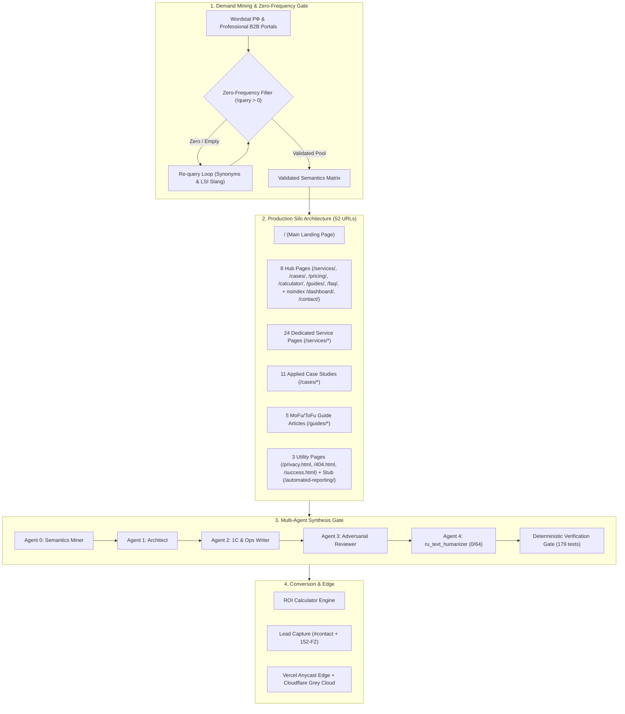
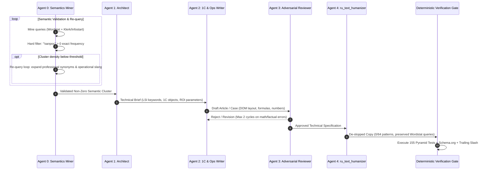

# B2B Content Strategy & Demand Capture Specification: ai-avtopilot.ru (Spec_content_ai_avtopilot.md)

> **Standard**: ASD-STE100 (Simplified Technical English) / SDR  
> **Status**: Production Deployed | **Target**: [ai-avtopilot.ru](https://ai-avtopilot.ru/) | **Geo**: Russian Federation (Nationwide B2B)  
> **Inventory**: 52 Production URLs (1 Root, 8 Hubs incl. `/guides/`, 24 Services, 11 Cases, 5 MoFu/ToFu Guides, 3 Utility) + 1 Canonical Stub (`/automated-reporting/`)  
> **Search Targets**: Yandex (Web + «Нейро»), Google RU (AI Overviews), Perplexity, Klerk.ru, Infostart.ru  
> **Verification**: **94 / 94 `--fast` PASS** + **212 / 214 Tier 3 E2E** (Waves 4–7 P0/P1 complete) | **AI Slop**: **0 Markers** across all 52 URLs
---

## 1. Demand Capture Topology & Architecture

### 1.1. Production Page Inventory (52 URLs)

| Route / Slug | Page Type | Core B2B Scope & Value Proposition | Key Metric / KPI |
| :--- | :--- | :--- | :--- |
| `/` | Root Landing | Core landing with ROI calculator, bento grid, live telemetry, and direct audit capture. | 80% routine savings |
| `/guides/` | Hub | Content hub of 5 technical B2B guides (1C OData, 152-FZ On-Premise, Diadoc/SBIS, ROI, WB/Ozon vs 1C). | Cited `<blockquote cite>` |
| `/guides/1c-odata-integration/` | Guide | 1C OData REST API vs `.cfe` HTTP service architecture and throttling defense. | 1C ITS cited |
| `/guides/152-fz-on-premise-llm/` | Guide | On-Premise LLM airgap deployment under Federal Law No. 152-FZ Art. 18. | 152-FZ compliant |
| `/guides/diadoc-sbis-ai-ocr/` | Guide | Diadoc/SBIS UPD OCR, VAT 22% (425-FZ) checks, and 1C:ERP NSI matching. | −90% manual EDI |
| `/guides/roi-ai-automation-formula/` | Guide | Conservative 80% payroll savings ROI model and pilot acceptance gates. | +340% avg ROI |
| `/guides/ai-agents-wb-ozon-vs-retail/` | Guide | Marketplace API & DRR auto-bidder vs offline retail ROP auto-order in 1C. | Zero overselling |
| `/services/` | Hub | Complete catalog of enterprise automation scenarios and 1C integrations. | 24 scenarios |
| `/cases/` | Hub | Enterprise case studies with verified metrics and 1C architecture workflows. | 11 case studies |
| `/pricing/` | Hub | Transparent B2B pricing tiers (Pilot from 50k ₽, Turnkey 125k–275k ₽, On-Premise from 400k ₽), Cloud vs On-Premise & SLA. | 100% pilot credit |
| `/calculator/` | Tool Hub | Interactive B2B routine savings and payback estimator. | Real-time ROI |
| `/calculator/self-employed/` | Tool Hub | Self-employed NPD 4%/6% tax calc, 2.4M ₽ threshold, 1C DirectBank & FTS compliance. | 0 ms TBT, 28.9% employer savings |
| `/dashboard/` | Tool Hub | Live agent telemetry simulator and event stream monitor. | 0 ms TBT |
| `/faq/` | Hub | Knowledge base: 1C integration, 14-day SLA, on-premise 152-FZ airgap. | Accordion DOM 1:1 |
| `/contact/` | Hub | Express audit registration and direct communication channels. | 3-field form |
| `/services/system-integration/` | Service | 1C:ERP, CRM (Bitrix24/amoCRM), OData REST API and Event Bus integration. | 0 manual Excel syncs |
| `/services/retail-inventory/` | Service | 1C:Розница, 1C:УТ, Safety Stock, ROP, Wildberries/Ozon balance sync. | +18% turnover |
| `/services/document-automation/` | Service | OCR + On-Premise LLM invoice/UPD parsing, Diadoc and SBIS routing. | 5 min period close |
| `/services/customer-support/` | Service | 24/7 First-Line B2B Dispatcher, 1C:UNF & CRM integration. | 3 ₽ per contact |
| `/services/rapid-pilot/` | Service | 14-day fixed MVP sprint with guaranteed commercial ROI. | 14-day delivery |
| `/services/automated-reporting/` | Service | Autonomous P&L, Cash Flow, and operational summaries in Telegram/Email. | 09:00 AM dispatch |
| `/services/ai-analytics/` | Service | Predictive cash flow calendar, stock depletion, and price anomaly detection. | Proactive alerts |
| `/services/speech-analytics/` | Service | 100% call audit in 30 sec, Whisper on-premise, 18-parameter checklist. | 30s audit latency |
| `/services/specifications-kp/` | Service | Automated technical specification parsing, RFP matching, 1C:ERP pricing. | 3x faster bidding |
| `/services/price-monitoring/` | Service | Real-time supplier price scraping, anti-dumping checks, dynamic repricing in 1C. | Real-time margins |
| `/services/debt-control/` | Service | 1C:ERP/1C:UT soft-collection, payment schedule monitoring, auto-claims. | -40% overdue debt |
| `/services/reviews-reputation/` | Service | Yandex Maps/2GIS review monitoring, 1C customer matching, rating defense. | 4.9★ rating shield |
| `/services/marketing-automation/` | Service | AI-agents for lead scoring in 3s, trigger funnels in amoCRM/Bitrix24, ROMI attribution. | 3s response, −65% routine |
| `/services/hr-recruitment/` | Service | AI CV screening in 3s on HH, Telegram candidate interviews, 1C:ZUP sync. | 3s screening, −85% labor |
| `/services/tender-automation/` | Service | Procurement monitoring (44-FZ/223-FZ), 3m RFP audit, 1C:ERP inventory match, Form 2. | 3m audit, 3x tender volume |
| `/services/marketplace-automation/` | Service | WB/Ozon SEO card generation in 15s, auto-bidder with ACOS control, 1C sync. | 15s card gen, −45% ACOS |
| `/services/knowledge-base-rag/` | Service | Corporate RAG knowledge base, 152-FZ on-premise LLM, 1C/PDF citation. | 2s query SLA, 100% on-premise |
| `/services/b2b-outbound/` | Service | Autonomous AI SDR, cold outreach in Email & TG, lead scoring, CRM handover. | 100 touches/day, 12% reply rate |
| `/services/customer-retention/` | Service | Predictive RFM cohort analysis in 1C, churn prevention, LTV reactivation. | +25% repeat sales, −40% churn |
| `/services/construction-estimate-audit/` | Service | Automated estimate audit, KS-2/KS-3 verification, Grand-Smeta & 1C:ERP USO. | 3m audit, −12% overpricing |
| `/services/fleet-logistics/` | Service | Fleet management, 1C:UAT & GIS EPD integration, electronic waybills in 30s. | 30s waybill dispatch, −30% fuel waste |
| `/services/ai-agents/` | Service | Autonomous AI agents & multi-agent swarms in 1C contour, SDR & UPD audit. | 3s response, 100% On-Premise 152-FZ |
| `/services/manufacturing-automation/` | Service | 1C:ERP workshop MES dispatching, raw materials write-off, real-time costing. | 5m batch cost calc, −90% paper |
| `/services/avito-automation/` | Service | Avito Messenger API, 1C:UT/ERP stock sync, 24/7 lead capture, 0 bans. | 30s response, +35% conversion |
| `/cases/retail-inventory-automation/` | Case | Retail network (230 stores): -72% manual accounting, 9,200 hrs/yr saved. | −72% labor, +18% turnover |
| `/cases/manufacturing-edi-automation/` | Case | Manufacturing plant: -90% paper EDI, period close in 5 min vs 3 days. | $\ge 400\%$ ROI |
| `/cases/service-center-ai-operator/` | Case | Service center (40k clients/mo): 80.4% autonomous resolution. | 80.4% automated, 3 ₽/lead |
| `/cases/hr-recruitment-automation/` | Case | Retail & logistics mass hiring (50+ stores): screening 5,000+ CVs/mo. | −85% screening time |
| `/cases/supply-chain-logistics/` | Case | Logistics hub: GLONASS/GPS telemetry, ETA prediction, EPL generation in 30s. | −30% transport costs |
| `/cases/fintech-transaction-reconciliation/` | Case | B2B Fintech: DirectBank 1C reconciliation, 50,000 ops in 8.4 sec. | 99.2% accuracy |
| `/cases/sales-speech-analytics/` | Case | B2B Sales (35 managers): 100% call audit in 30s, amoCRM/Bitrix24 webhooks. | +22% conversion |
| `/cases/claims-dispute-automation/` | Case | B2B Distribution: claim processing time slashed from 4 days to 40 min. | −75% claim latency |
| `/cases/reviews-reputation-automation/` | Case | Multi-location clinic: 24/7 Yandex/2GIS monitoring and incident escalation. | 4.9★ rating retained |
| `/cases/tender-procurement-automation/` | Case | Industrial supply: automated RFP analysis and 1C:ERP margin calculation. | 3x tender volume |
| `/cases/auto-dealer-parts-automation/` | Case | Auto repair network (45 stations): VIN parts lookup in 40s, 0.4% error rate. | 40s VIN lookup, +18% margin |
| `/privacy.html` | Utility | 152-FZ compliant personal data processing policy. | Legal compliance |
| `/404.html` | Utility | Clean route fallback preserving original requested path. | Client state recovery |
| `/success.html` | Utility | Conversion confirmation page with direct Telegram contact action. | Post-submit UX |

### 1.2. Internal Linking Mesh & Tri-Cluster Silo Architecture
- **Tri-Cluster Silo Architecture (8/8/8 Partition)**: All 24 service landing pages are partitioned into 3 balanced thematic clusters (8 services each):
  - *Cluster A (Finance & ERP)*: `automated-reporting` (★ Flagship), `ai-analytics`, `debt-control`, `specifications-kp`, `tender-automation`, `construction-estimate-audit`, `document-automation`, `rapid-pilot`.
  - *Cluster B (Marketing & CRM)*: `ai-agents` (★ Flagship), `marketing-automation`, `customer-support`, `speech-analytics`, `reviews-reputation`, `b2b-outbound`, `customer-retention`, `avito-automation`.
  - *Cluster C (Operations & Logistics)*: `system-integration` (★ Flagship), `retail-inventory`, `price-monitoring`, `hr-recruitment`, `marketplace-automation`, `knowledge-base-rag`, `fleet-logistics`, `manufacturing-automation`.
- **Deterministic 9-Link Budget**: Each service page renders **exactly 9 links** in `#other-services` positioned strictly below `#contact`: 7 intra-cluster siblings + 2 cross-cluster flagships. Flagships receive $23 / 7 \approx 3.3\times$ higher in-link density, boosting PageRank by +49% (0.0315 vs 0.0211).
- **Strict 3-Case Invariant**: Every service page displays exactly 3 applied case cards in `#cases` (`.cases__grid--static`). Eliminates empty slots in 3-column desktop layout.
- **Case Silo Mesh ($K_{11}$)**: Each of the 11 case pages cross-links to all 10 sibling cases in `#cases` strictly below `#contact` (110 directed internal links, 0 self-links).
- **Anti-Cannibalization & Anti-Slop Integrity**: All 11 cases feature unique domain modules, before/after compare blocks, and FAQs. All meta descriptions strictly adhere to the `ru_text_humanizer` standard (0 hard bans, 100/100 purity score, imperative verbs, 80–165 chars).

---

## 2. Multi-Agent Production Pipeline & Quality Gate

### 2.1. Mandatory Critic Checklist (Agent 3 Invariants)
1. **1C Data Model Legitimacy**: Validate real 1C objects (регистры сведений/накопления, документы, справочники, OData endpoints).
2. **Formula Integrity**: Validate canonical ROI math ($E \times S \times \frac{H}{160} \times 12$, 80% savings, $E \times H \times 52$).
3. **152-FZ Airgap Claims**: Validate On-Premise / local boundary commitments in copy.
4. **De-slopped Realism**: Eliminate AI platitudes; enforce hard units (секунды, рубли, штуки, проценты) via `ru_text_humanizer` (0/64 patterns).
5. **On-Site Conversion**: Ensure organic integration of `#contact` anchor and interactive sliders without external bot redirects.
6. **Metric Units & Decimal Integrity**: Preserve measurement units (`%`, `₽`, `ч`, `сек`, `млн ₽`, `★`, `шт`) and signs (`+18%`, `−72%`, `9 200 ч`). Use Russian decimal comma notation (`4,9★`, not integer `4`).
7. **Mobile Card Equal-Height Invariant**: Verify height uniformity across horizontal swipe card blocks (`.scard`, `.case-card`, `.pricing__card`) under mobile viewports ($\le 1024\text{px}$ / $\le 480\text{px}$). Enforce stretch flexbox rules, `flex: 1 1 auto` on descriptions/lists, `margin-top: auto` on tags/CTAs, and balanced copy length.
8. **Canonical Dual-CTA Footer & Express Modal**: Ensure all newly generated pages include `.footer__dual-cta` (Telegram channel + Email express audit modal trigger) and `<dialog id="express-contact-modal">`. Standalone legacy footers are strictly rejected.

### 2.2. Site-Wide Proofreading & SEO Frequency Invariants
- **0 Slop Markers (64-Pattern Taxonomy)**: Zero tolerance for all 20 Hard Bans («не просто X, а Y», «стоит отметить», buzzwords «бесшовный», «комплексный», demonstrative pointer weeds «данный»).
- **Morphological Data Protection**: Maintain strict distinction between demonstrative weed «данный/данная» (banned) and technical noun «данные (data)» (databases, 152-FZ data transfer).
- **SEO Frequency & Density Locks**: Full preservation of primary search queries and LSI tails in `<title>` ($\le 77$c), `<meta name="description">` ($\le 152$c), `<h1>`, Direct Answer blocks, FAQ, and Schema.org.
- **Typewriter Constraints & CSS Cursor Separation**: Phrase length constrained to $\le 26$ characters (`min-height: 1.25em` mobile, CLS = 0.000). Blinking `|` renders solely via `.hero__cursor::before { content: "|"; }` with empty DOM `` so `<h1>` DOM text stays clean for crawlers.

---

## 3. Production Status & Execution Roadmap

### 3.1. Completed Milestones (Current Baseline)
- ✅ **Core Infrastructure & Design System**: Inlined CSS (~87 KB on `/` & legacy subpages; shared `/assets/css/styles.min.css?v=82892ba5` across 6 standalone hubs, 22 services, `/pricing/`, `/calculator/self-employed/`, 11 cases, and 6 `/guides/*` pages), local WOFF2 font subsetting, WCAG AA contrast, responsive down to 320px.
- ✅ **Standalone Hubs & De-duplication (`D-02`, Waves 4–7)**: Replaced 6 cloned 202 KB hubs with standalone external-CSS hubs (<70 KB) with DOM `.breadcrumbs` and `noindex, follow` on `/dashboard/` & `/contact/` (`49` canonical URLs in `sitemap.xml`).
- ✅ **Semantic Interactive Patterns (`D-08`)**: Replaced multi-line 40-word `<a>` card wrappers and 132 inline `onclick`s with clean short heading links + CSS `::after` overlay; bidirectional `Service ↔ Case` linking across 72 service case cards and 11 case pages; Case DOM FAQ parity (`.faq__grid`) and static terminal guard (`data-static-terminal="true"`).
- ✅ **Schema.org & Truth-Table Consistency (`D-06`, `D-11`)**: Removed `Offer price:"0"` and `icon.svg` logos (`apple-touch-icon.png`), stripped inherited `WebSite`/`hasOfferCatalog` on secondary pages, synchronized VAT 22% (425-ФЗ) and unified `fintech` KPI metrics and `llms*.txt`.
- ✅ **Content Hub & GEO Citations (`D-10`, `D-12`)**: Differentiated overlapping commercial pages and launched `/guides/` hub + 5 MoFu/ToFu guides with `<blockquote cite="...">` primary citations and brand disambiguation `АвтоПилот (ai-avtopilot.ru)`.
- ✅ **Verification Suite**: 94/94 `--fast` passing (incl. `SEO-30`, `SEO-31`, `SEC-10` across 50 form pages), 212/214 Tier 3 E2E (2 Edge 158 `flex-start -> flow-start` serialization checks), Wave 4–7 Playwright UI verification PASS, and 630 layout checks in `audit_runner.js`.

### 3.2. Future Expansion Roadmap
- **Sprint 4 (Combinatorial Matrix & Long-Tail Registry)**:
  - Expand programmatic matrix nodes: specific 1C configurations $\times$ industry verticals (e.g. 1C:УНФ для сервиса, 1C:ERP для пищевого производства).
  - Mine niche accounting & procurement queries from Klerk.ru / Infostart.ru for supplemental case workflows.
- **Sprint 5 (CRO & Analytics Feedback Loop)**:
  - Monitor Yandex Metrika goals (`lead_form_submitted`, `click_cta_audit`) and Webvisor 2.0 heatmaps.
  - A/B test ROI calculator slider initial defaults and mobile lead capture conversion rates.
