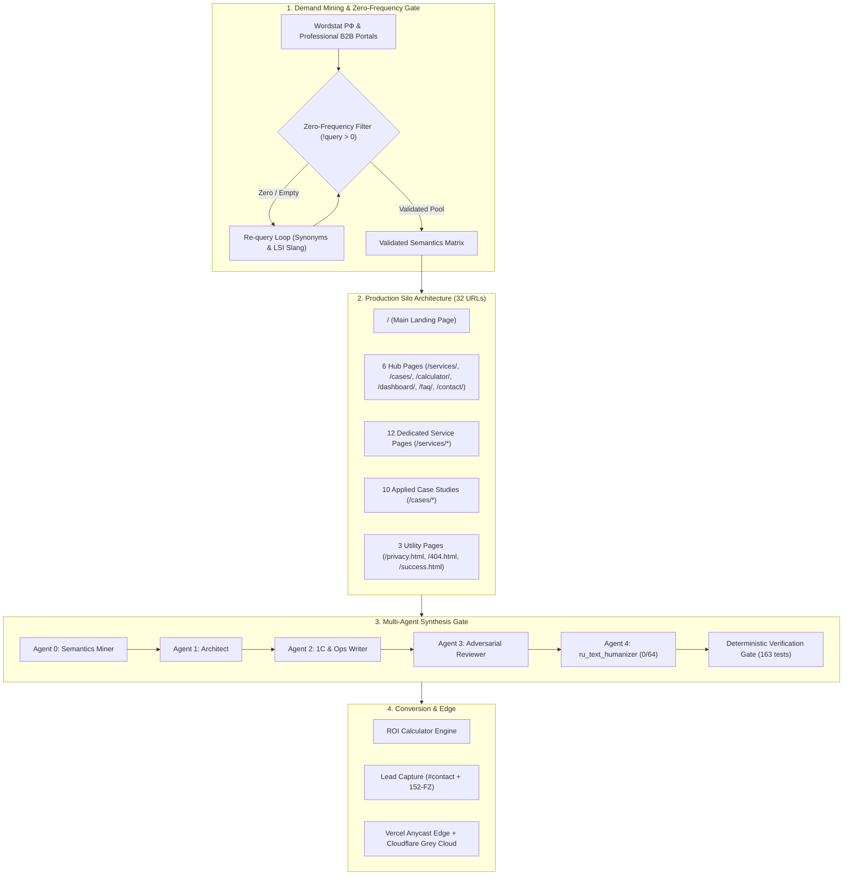
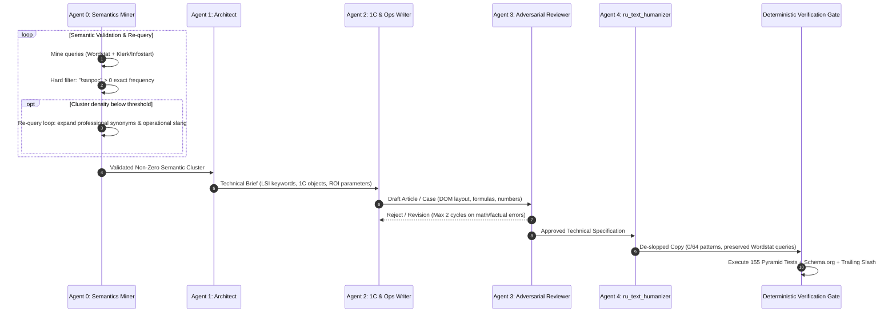

# B2B Content Strategy & Demand Capture Engine: ai-avtopilot.ru

> **Status**: Production Deployed | **Target**: [ai-avtopilot.ru](https://ai-avtopilot.ru/) | **Geo**: Russian Federation (Nationwide B2B)  
> **Inventory**: 32 Production URLs (1 Root, 6 Hubs, 12 Services, 10 Cases, 3 Utility)  
> **Search Targets**: Yandex (Web + «Нейро»), Google RU (AI Overviews), Perplexity, Klerk.ru, Infostart.ru  
> **Verification**: **153 / 153 PASS** (Tier 1: 11 Unit + Tier 2: 54 Static + Tier 3: 88 Browser E2E) | **AI Slop**: **0 Markers** across all 32 URLs

---

## 1. Demand Capture Topology & Architecture

### 1.1. Production Page Inventory (32 URLs)

| Route / Slug | Page Type | Core B2B Scope & Value Proposition | Key Metric / KPI |
| :--- | :--- | :--- | :--- |
| `/` | Root Landing | Core landing with ROI calculator, bento grid, live telemetry, and direct audit capture. | 80% routine savings |
| `/services/` | Hub | Complete catalog of enterprise automation scenarios and 1C integrations. | 12 scenarios |
| `/cases/` | Hub | Enterprise case studies with verified metrics and 1C architecture workflows. | 10 case studies |
| `/calculator/` | Tool Hub | Interactive B2B routine savings and payback estimator. | Real-time ROI |
| `/dashboard/` | Tool Hub | Live agent telemetry simulator and event stream monitor. | 0 ms TBT |
| `/faq/` | Hub | Knowledge base: 1C integration, 14-day SLA, on-premise 152-FZ airgap. | Accordion DOM 1:1 |
| `/contact/` | Hub | Express audit registration and direct communication channels. | 3-field form |
| `/services/system-integration/` | Service | 1C:ERP, CRM (Bitrix24/amoCRM), OData REST API and Event Bus integration. | 0 manual Excel syncs |
| `/services/retail-inventory/` | Service | 1C:Розница, 1C:УТ, Safety Stock, ROP, Wildberries/Ozon balance sync. | +18% turnover |
| `/services/document-automation/` | Service | OCR + On-Premise LLM invoice/UPD parsing, Diadoc and SBIS routing. | 5 min period close |
| `/services/customer-support/` | Service | 24/7 First-Line B2B Dispatcher, 1C:UNF & CRM integration. | 3 ₽ per contact |
| `/services/rapid-pilot/` | Service | 14-day fixed MVP sprint with guaranteed commercial ROI. | 14-day delivery |
| `/services/automated-reporting/` | Service | Autonomous P&L, Cash Flow, and operational summaries in Telegram/Email. | 09:00 AM dispatch |
| `/services/ai-analytics/` | Service | Predictive cash flow calendar, stock depletion, and price anomaly detection. | Proactive alerts |
| `/services/speech-analytics/` | Service | 100% call audit in 30 sec, Whisper on-premise, 18-parameter checklist. | 30s audit latency |
| `/services/specifications-kp/` | Service | Automated technical specification parsing, RFP matching, 1C:ERP pricing. | 3x faster bidding |
| `/services/price-monitoring/` | Service | Real-time supplier price scraping, anti-dumping checks, dynamic repricing in 1C. | Real-time margins |
| `/services/debt-control/` | Service | 1C:ERP/1C:UT soft-collection, payment schedule monitoring, auto-claims. | -40% overdue debt |
| `/services/reviews-reputation/` | Service | Yandex Maps/2GIS review monitoring, 1C customer matching, rating defense. | 4.9★ rating shield |
| `/cases/retail-inventory-automation/` | Case | Retail network (230 stores): -72% manual accounting, 9,200 hrs/yr saved. | −72% labor, +18% turnover |
| `/cases/manufacturing-edi-automation/` | Case | Manufacturing plant: -90% paper EDI, period close in 5 min vs 3 days. | $\ge 400\%$ ROI |
| `/cases/service-center-ai-operator/` | Case | Service center (40k clients/mo): 80.4% autonomous resolution. | 80.4% automated, 3 ₽/lead |
| `/cases/hr-recruitment-automation/` | Case | Retail & logistics mass hiring (50+ stores): screening 5,000+ CVs/mo. | −85% screening time |
| `/cases/supply-chain-logistics/` | Case | Logistics hub: GLONASS/GPS telemetry, ETA prediction, EPL generation in 30s. | −30% transport costs |
| `/cases/fintech-transaction-reconciliation/` | Case | B2B Fintech: DirectBank 1C reconciliation, 50,000 ops in 8.4 sec. | 99.2% accuracy |
| `/cases/sales-speech-analytics/` | Case | B2B Sales (35 managers): 100% call audit in 30s, amoCRM/Bitrix24 webhooks. | +22% conversion |
| `/cases/claims-dispute-automation/` | Case | B2B Distribution: claim processing time slashed from 4 days to 40 min. | −75% claim latency |
| `/cases/reviews-reputation-automation/` | Case | Multi-location clinic: 24/7 Yandex/2GIS monitoring and incident escalation. | 4.9★ rating retained |
| `/cases/tender-procurement-automation/` | Case | Industrial supply: automated RFP analysis and 1C:ERP margin calculation. | 3x tender volume |
| `/privacy.html` | Utility | 152-FZ compliant personal data processing policy. | Legal compliance |
| `/404.html` | Utility | Clean route fallback preserving original requested path. | Client state recovery |
| `/success.html` | Utility | Conversion confirmation page with direct Telegram contact action. | Post-submit UX |

### 1.2. Internal Linking Mesh & Hierarchy
- **Service Silo Mesh ($K_{12}$)**: Each of the 12 service pages cross-links to all 11 sibling services in `#other-services` placed strictly below `#contact` (132 directed internal links, 0 self-links, 0 redirect hops).
- **Strict 3-Case Invariant**: Every service page displays exactly 3 applied case cards in `#cases` (`.cases__grid--static`). Eliminates empty slots in 3-column desktop layout.
- **Case Silo Mesh ($K_{10}$)**: Each of the 10 case pages cross-links to all 9 sibling cases in `#cases` strictly below `#contact` (90 directed internal links, 0 self-links).

---

## 2. Multi-Agent Production Pipeline & Quality Gate

### 2.1. Mandatory Critic Checklist (Agent 3 Invariants)
1. **1C Data Model Legitimacy**: Validate real 1C objects (регистры сведений/накопления, документы, справочники, OData endpoints).
2. **Formula Integrity**: Validate canonical ROI math ($E \times S \times \frac{H}{160} \times 12$, 80% savings, $E \times H \times 52$).
3. **152-FZ Airgap Claims**: Validate On-Premise / local boundary commitments in copy.
4. **De-slopped Realism**: Eliminate AI platitudes; enforce hard units (секунды, рубли, штуки, проценты) via `ru_text_humanizer` (0/64 patterns).
5. **On-Site Conversion**: Ensure organic integration of `#contact` anchor and interactive sliders without external bot redirects.
6. **Metric Units & Decimal Integrity**: Preserve measurement units (`%`, `₽`, `ч`, `сек`, `млн ₽`, `★`, `шт`) and signs (`+18%`, `−72%`, `9 200 ч`). Use Russian decimal comma notation (`4,9★`, not integer `4`).
7. **Mobile Card Equal-Height Invariant**: Verify height uniformity across horizontal swipe card blocks (`.scard`, `.case-card`) under mobile viewports ($\le 480\text{px}$). Enforce stretch flexbox rules, `flex: 1 1 auto` on descriptions, `margin-top: auto` on tags/CTAs, and balanced copy length.
8. **Canonical Dual-CTA Footer & Express Modal**: Ensure all newly generated pages include `.footer__dual-cta` (Telegram channel + Email express audit modal trigger) and `<dialog id="express-contact-modal">`. Standalone legacy footers are strictly rejected.

### 2.2. Site-Wide Proofreading & SEO Frequency Invariants
- **0 Slop Markers (64-Pattern Taxonomy)**: Zero tolerance for all 20 Hard Bans («не просто X, а Y», «стоит отметить», buzzwords «бесшовный», «комплексный», demonstrative pointer weeds «данный»).
- **Morphological Data Protection**: Maintain strict distinction between demonstrative weed «данный/данная» (banned) and technical noun «данные (data)» (databases, 152-FZ data transfer).
- **SEO Frequency & Density Locks**: Full preservation of primary search queries and LSI tails in `<title>` ($\le 77$c), `<meta name="description">` ($\le 152$c), `<h1>`, Direct Answer blocks, FAQ, and Schema.org.
- **Typewriter Constraints**: Phrase length constrained to $\le 19$ characters (`min-height: 1.25em` mobile, CLS = 0.000).

---

## 3. Production Status & Execution Roadmap

### 3.1. Completed Milestones (Current Baseline)
- ✅ **Core Infrastructure & Design System**: Inlined CSS (~97 KB), local WOFF2 font subsetting, WCAG AA contrast, responsive down to 320px.
- ✅ **Multi-Entry Hybrid SSG Engine**: Synchronization across 6 hubs and tools via `sync_pages.py`.
- ✅ **Dedicated Service Silos**: 12 production service landing pages deployed, verified, and indexed.
- ✅ **Applied Case Study Cluster**: 10 real-world B2B case studies deployed with verified ROI metrics and 3-level Schema.org graphs.
- ✅ **Site-Wide Desloping**: All 32 URLs proofread via `ru_text_humanizer` (0 slop markers, 100% Wordstat keyword retention).
- ✅ **Linking Mesh & Navigation**: $K_{12}$ mesh across 12 services (132 links), $K_{10}$ mesh across 10 cases (90 links), strict 3-case invariant on service pages.
- ✅ **Verification Suite**: 163/163 tests passing in `tests/run_all.js` + 486 layout checks in `audit_runner.js`.

### 3.2. Future Expansion Roadmap
- **Sprint 4 (Combinatorial Matrix & Long-Tail Registry)**:
  - Expand programmatic matrix nodes: specific 1C configurations $\times$ industry verticals (e.g. 1C:УНФ для сервиса, 1C:ERP для пищевого производства).
  - Mine niche accounting & procurement queries from Klerk.ru / Infostart.ru for supplemental case workflows.
- **Sprint 5 (CRO & Analytics Feedback Loop)**:
  - Monitor Yandex Metrika goals (`lead_form_submitted`, `click_cta_audit`) and Webvisor 2.0 heatmaps.
  - A/B test ROI calculator slider initial defaults and mobile lead capture conversion rates.
