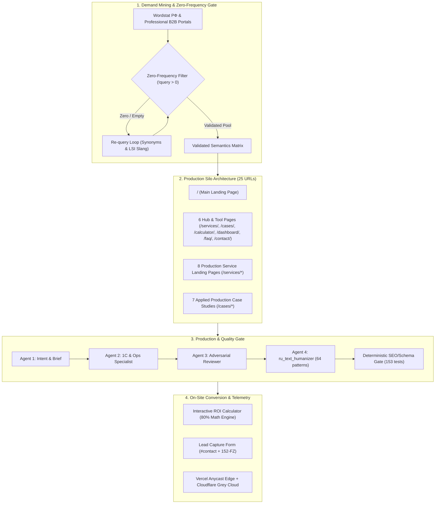
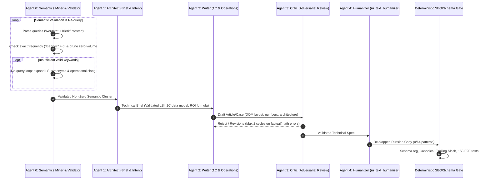

# B2B Content Strategy & Demand Capture Engine: ai-avtopilot.ru (v3 Production)

> **Status**: Production Deployed | **Target**: [ai-avtopilot.ru](https://ai-avtopilot.ru/) | **Geo**: Russian Federation (Nationwide B2B)  
> **Conversion Model**: Direct On-Site (ROI Calculator + `#contact` Audit Form; zero external bot qualification)  
> **Search Targets**: Yandex (Web + «Нейро»), Google RU (AI Overviews), Perplexity, Professional communities (Klerk, Infostart)  
> **Verification**: **153 / 153 PASS** (Tier 1: 11 Unit + Tier 2: 54 Static + Tier 3: 88 Browser E2E) | **AI Slop**: **0 Markers** across all 27 URLs

---

## 1. Demand Capture Topology & Architecture

### 1.1. Production Page Inventory (27 Active URLs)
- **Root Main Landing (`/`)**: High-converting core page with dynamic typewriter, ROI engine, 6-module bento grid, live telemetry dashboard, and direct audit capture.
- **Hub & Tool Subpages (6 URLs)**:
  - `/services/` — Complete catalogue of enterprise automation scenarios.
  - `/cases/` — Real-world business implementation results and ROI proofs.
  - `/calculator/` — Interactive B2B routine savings and payback estimator.
  - `/dashboard/` — Live telemetry simulator and autonomous agent monitor.
  - `/faq/` — B2B knowledge base (1C integration, 14-day SLA, 152-FZ on-premise security).
  - `/contact/` — Express audit registration and direct contact channels.
- **Dedicated Service Landing Pages (10 URLs, `/services/*`)**:
  1. `/services/system-integration/` — 1C ERP, CRM (Bitrix24 / amoCRM), OData REST API & Event Bus.
  2. `/services/retail-inventory/` — 1C:Розница, 1C:УТ, Safety Stock, ROP, Wildberries & Ozon balance sync.
  3. `/services/document-automation/` — OCR + On-Premise LLM invoice / UPD extraction, Diadoc & SBIS routing.
  4. `/services/customer-support/` — 24/7 First-Line B2B Dispatcher, 1C:UNF & CRM integration.
  5. `/services/rapid-pilot/` — 14-Day Fixed MVP Sprint with guaranteed commercial ROI.
  6. `/services/automated-reporting/` — Autonomous P&L, Cash Flow, and operational summaries in Telegram/Email.
  7. `/services/ai-analytics/` — Predictive cash flow calendar, stock depletion & price anomaly detection.
  8. `/services/speech-analytics/` — 100% call audit in 30 sec, Whisper on-premise, 18-parameter checklist, amoCRM/Bitrix24 webhooks.
- **Dedicated Applied Case Studies (7 URLs, `/cases/*`)**:
  1. `/cases/retail-inventory-automation/` — Retail network (230 stores): -72% manual accounting, +18% turnover, 9,200 hrs/yr saved.
  2. `/cases/manufacturing-edi-automation/` — Manufacturing plant: -90% paper EDI, period close in 5 min vs 3 days, $\ge 400\%$ ROI.
  3. `/cases/service-center-ai-operator/` — Service center (40k clients/mo): 80.4% autonomous resolution, 3 ₽ per contact, 1C:UNF.
  4. `/cases/hr-recruitment-automation/` — Retail & Logistics mass hiring (50+ stores): screening 5,000+ CVs/mo, -85% screening time, 1C:ZUP.
  5. `/cases/supply-chain-logistics/` — Logistics hub: GLONASS/GPS telemetry, ETA prediction, EPL generation in 30 sec, -30% transport costs.
  6. `/cases/fintech-transaction-reconciliation/` — B2B Fintech: DirectBank 1C reconciliation, 50,000 ops in 8.4 sec, 99.2% accuracy.
  7. `/cases/sales-speech-analytics/` — B2B Sales & Distribution (35 managers): 100% call audit in 30 sec, -85% QA cost, +22% conversion, amoCRM/Bitrix24.
- **System & Legal Pages (3 URLs)**: `/privacy.html` (152-FZ compliant), `/404.html` (clean route fallback), `/success.html`.
- **Machine Discovery & Compliance Assets**:
  - `/llms.txt`, `/llms-full.txt` (structured markdown indexation for LLMs and autonomous agents).
  - `/.well-known/security.txt` (RFC 9116 security contact standards).
  - `/d8a24f0c9b7e416a9e3d81b7e651c4a0.txt` (IndexNow instant indexing protocol token).
  - `/yandex_cd29b4304b5e16c6.html` (Yandex Webmaster ownership verification).

### 1.2. Generative Search Semantic Requirements (Yandex «Нейро», Perplexity, AI Overviews)
- **Direct Answer Synthesis**: Factual, structured summaries embedded in Hero subtitles, FAQ accordions, and JSON-LD Schema.org graphs answering commercial intents instantly (exact stack, timelines, pricing model, compliance).
- **Technical & DOM Alignment**: Zero CLS (0.000), fixed-dimension elements, and negative invariants strictly governed by [ARCHITECTURE.md §6 & §9.2](file:///d:/AI/data/ai-avtopilot/ARCHITECTURE.md).

### 1.3. SOTA SEO Internal Linking Mesh & Funnel Repositioning
- **Complete Silo Mesh ($K_8$ Graph)**: Every dedicated service landing page (`/services/*`) features the «Другие сценарии» (`#other-services`) block located strictly below the `#contact` lead form. It links to all 7 other services in the cluster (56 directed internal links, zero self-links, 0 redirect hops with strict trailing slashes).
- **Exit-Intent Conversion Hierarchy**:
  - Services: primary conversion point (`#contact`) precedes sibling scenario exploration (`#other-services`), eliminating Hick's Law bounce.
  - Cases: primary conversion point (`#contact`) precedes related case studies (`#cases` «Другие кейсы»).
- **Zero-Collision Carousel Isolation**: Scoped mobile touch carousel dots (`#other-services-dots`) prevent event listener collisions with feature modules (`.services__bento` / `#services-dots`).

---

## 2. Production Pipeline & Multi-Agent Quality Gate

### 2.0. Step 0: Semantic Parsing, Zero-Frequency Gate & Re-Query Loop
1. **Demand Mining**: Collect raw and exact Wordstat RF frequencies, Yandex search suggestions, and operational pain points from Klerk.ru and Infostart.ru.
2. **Zero-Frequency Pruning Gate**: Hard filter enforcing `"!query" > 0` exact frequency. Queries with zero confirmed monthly volume are strictly excluded from `<title>`, `<meta description>`, `<h1>`/`<h2>` tags, and focus clusters.
3. **Autonomous Re-Query Loop**: If post-filter cluster density falls below the viability threshold, automatically expand seed keywords with professional accounting/procurement synonyms and operational slang, re-submitting them to the frequency validation loop.
4. **Handoff to Production**: Only verified non-zero semantic clusters proceed to Agent 1 (Architect) for technical brief compilation.

### 2.1. Multi-Agent Synthesis Protocol

### 2.2. Mandatory Critic Checklist (Agent 3 Invariants)
1. **1C Data Model Legitimacy**: Validate real 1C objects (регистры накопления/сведений, документы, справочники, OData/REST endpoints).
2. **Formula Integrity**: Verify strict compliance with the canonical ROI mathematical contract in [ARCHITECTURE.md §4.1](file:///d:/AI/data/ai-avtopilot/ARCHITECTURE.md#41-roi-calculator-exact-specifications) (80% routine efficiency, non-speculative hours/salary).
3. **152-FZ Airgap Claims**: Validate On-Premise / local boundary commitments in copy per [ARCHITECTURE.md §7](file:///d:/AI/data/ai-avtopilot/ARCHITECTURE.md#7-security--zero-trust-hardening).
4. **De-slopped Realism**: Elimination of AI platitudes; hard units only (секунды, рубли, штуки, проценты) adhering to `ru_text_humanizer` (0/64 patterns).
5. **On-Site Conversion Flow**: Organic integration of `#contact` anchor and interactive sliders without external bot qualification.
6. **Metric Units & Signs Integrity (ADR 2026-10-02)**: Mandatory preservation of measurement units (`%`, `₽`, `ч`, `сек`, `млн ₽`) and signs (`+18%`, `−72%`, `9 200 ч`, `1 сек`) across all KPI blocks and case results.

### 2.3. Site-Wide Proofreading & SEO Frequency Invariant
> **Canonical Site-Wide Proofreading Invariant**: Continuous proofreading and desloping of all pages across [ai-avtopilot.ru](https://ai-avtopilot.ru/) must be executed strictly via the [`ru_text_humanizer`](file:///d:/AI/.agents/skills/ru_text_humanizer/SKILL.md) skill **with zero semantic degradation and mandatory preservation of verified SEO frequency (Yandex Wordstat) on every single page**.
- **0 Slop Markers (64-Pattern Taxonomy)**: Total elimination of all 20 Hard Bans («не просто X, а Y», «стоит отметить», buzzwords «бесшовный», «комплексный», demonstrative pointer weeds «данный»).
- **Morphological Data Protection**: Strict distinction between the demonstrative weed «данный/данная» (banned) and the technical noun «данные (data)» (databases, data transfer, 152-FZ compliance).
- **SEO Frequency & Density Locks**: Full preservation of primary search queries and LSI tails in `<title>` (30–85 chars), `<meta name="description">` (70–175 chars), `<h1>`, Direct Answer blocks, FAQ accordions, and Schema.org graphs.
- **Engineering Invariants**: Typewriter phrase length constrained to $\le 19$ characters (`min-height: 1.25em` mobile, CLS = 0.000, zero multi-line wrap jitter), preserving 153/153 tests without regression.

---

## 3. Production Status & Execution Roadmap

### 3.1. Completed Milestones (Current Baseline)
- ✅ **Core Infrastructure & Design System**: Inlined zero-blocking CSS (~97KB), local WOFF2 font subsetting, WCAG AA strict contrast, responsive down to 320px.
- ✅ **Multi-Entry Hybrid SSG Engine**: Synchronization across all 6 hubs/tools via `sync_pages.py`.
- ✅ **Scenario Landing Cluster**: 8 production service landing pages deployed and verified.
- ✅ **Applied Case Study Cluster**: 7 real-world B2B case studies deployed with hard ROI metrics and 3-level Schema.org graphs.
- ✅ **Site-Wide Desloping & SEO Hardening**: All 25 URLs proofread via `ru_text_humanizer` (0 slop markers, 100% Wordstat keyword retention).
- ✅ **SOTA SEO Internal Linking & Subpage Repositioning**: Strongly connected $K_8$ mesh across all 8 service silos, sibling discovery moved below `#contact` across services and cases, dedicated dots/carousel isolation (`#other-services-dots`), 0 circular self-links.
- ✅ **Verification Suite**: 155/155 tests passing (Tier 1: 11 Unit + Tier 2: 56 Static + Tier 3: 88 Browser E2E).

### 3.2. Future Expansion Roadmap
- **Sprint 4 (Long-Tail Semantic Expansion & Registry Completion)**:
  - Profile the 5 remaining case studies in `data/cases_semantics.json` (`manufacturing-edi-automation`, `service-center-ai-operator`, `hr-recruitment-automation`, `supply-chain-logistics`, `fintech-transaction-reconciliation`).
  - Mine secondary zero-search accounting & procurement queries from Klerk/Infostart for additional niche case studies.
  - Expand combinatorial programmatic matrix nodes (specific 1C configurations $\times$ industry verticals).
- **Sprint 5 (CRO & Analytics Feedback Loop)**:
  - Monitor Yandex Metrika goals (`lead_form_submitted`, `click_cta_audit`) and Webvisor 2.0 heatmaps.
  - A/B test ROI calculator slider initial defaults and mobile lead capture conversion rates.
